# Smart Hydration Sensor — Detailed Design

# Table of Contents
- [Smart Hydration Sensor — Detailed Design](#smart-hydration-sensor--detailed-design)
- [Table of Contents](#table-of-contents)
- [1. Overview](#1-overview)
    - [1.0.1. Review Notation](#101-review-notation)
  - [1.1. Problem Statement](#11-problem-statement)
  - [1.2. Definitions](#12-definitions)
- [2. Requirements](#2-requirements)
  - [2.1. Constraints](#21-constraints)
    - [2.1.1. Constraint 1 — Bioimpedance Does Not Directly Measure Hydration](#211-constraint-1--bioimpedance-does-not-directly-measure-hydration)
    - [2.1.2. Constraint 2 — Absolute Hydration Requires External Validation](#212-constraint-2--absolute-hydration-requires-external-validation)
    - [2.1.3. Constraint 3 — Motion During Exercise Will Corrupt BioZ](#213-constraint-3--motion-during-exercise-will-corrupt-bioz)
    - [2.1.4. Constraint 4 — Sweat Is Both the Target Context and a Major Artifact](#214-constraint-4--sweat-is-both-the-target-context-and-a-major-artifact)
    - [2.1.5. Constraint 5 — Temperature Changes Can Mimic Fluid Changes](#215-constraint-5--temperature-changes-can-mimic-fluid-changes)
    - [2.1.6. Constraint 6 — Electrode Repositioning May Be Larger Than the Hydration Signal](#216-constraint-6--electrode-repositioning-may-be-larger-than-the-hydration-signal)
    - [2.1.7. Constraint 7 — MAX30009 Driver Support Requires Project Integration Work](#217-constraint-7--max30009-driver-support-requires-project-integration-work)
    - [2.1.8. Constraint 8 — Electrical Safety Must Be Reviewed Before Human Testing](#218-constraint-8--electrical-safety-must-be-reviewed-before-human-testing)
    - [2.1.9. Constraint 9 — Garmin Watch Integration Is Secondary](#219-constraint-9--garmin-watch-integration-is-secondary)
    - [2.1.10. Assumption 1 — A Personal Baseline Is Stable Enough to Use](#2110-assumption-1--a-personal-baseline-is-stable-enough-to-use)
  - [2.2. User Requirements](#22-user-requirements)
    - [Legend](#legend)
  - [2.3. Design Risks](#23-design-risks)
- [3. High-Level Solution](#3-high-level-solution)
  - [3.1. System Architecture](#31-system-architecture)
  - [3.2. Planned Software Components and Ownership](#32-planned-software-components-and-ownership)
  - [4.1. Measurement Hardware](#41-measurement-hardware)
    - [4.1.1. Selected AFE: MAX30009](#411-selected-afe-max30009)
    - [4.1.2. Selected MCU and Development Kit: nRF52840](#412-selected-mcu-and-development-kit-nrf52840)
    - [4.1.3. Digital Interface](#413-digital-interface)
    - [4.1.4. MAX30009EVKIT Use](#414-max30009evkit-use)
    - [4.1.5. nRF52840-to-MAX30009 Electrical Handoff](#415-nrf52840-to-max30009-electrical-handoff)
    - [4.1.6. Selected Auxiliary Sensors: ADXL362 (Motion) and MCP9808 (Temperature)](#416-selected-auxiliary-sensors-adxl362-motion-and-mcp9808-temperature)
  - [4.2. Electrode Geometry — Pending Final Decision](#42-electrode-geometry--pending-final-decision)
    - [4.2.1. Candidate Geometry A — Cross-Arm Tetrapolar](#421-candidate-geometry-a--cross-arm-tetrapolar)
    - [4.2.2. Candidate Geometry B — Same-Side Longitudinal Tetrapolar Strip](#422-candidate-geometry-b--same-side-longitudinal-tetrapolar-strip)
    - [4.2.3. Geometry Selection Test](#423-geometry-selection-test)
    - [4.2.4. Electrode Placement Rules](#424-electrode-placement-rules)
  - [4.3. Math From AFE to Fluid-Trend Output](#43-math-from-afe-to-fluid-trend-output)
    - [4.3.0. Circuit Intuition and Processing Order](#430-circuit-intuition-and-processing-order)
    - [4.3.1. Frequency Sweep](#431-frequency-sweep)
    - [4.3.2. Raw I/Q Acquisition](#432-raw-iq-acquisition)
    - [4.3.3. Raw Complex Voltage](#433-raw-complex-voltage)
    - [4.3.4. Raw Complex Impedance](#434-raw-complex-impedance)
    - [4.3.5. Per-Frequency Complex Calibration](#435-per-frequency-complex-calibration)
    - [4.3.6. Complex Impedance Features](#436-complex-impedance-features)
    - [4.3.7. Cole Model Fit](#437-cole-model-fit)
    - [4.3.8. Derived Intracellular Resistance](#438-derived-intracellular-resistance)
    - [4.3.9. Primary Internal Metric — RFDS](#439-primary-internal-metric--rfds)
    - [4.3.10. Primary Algorithmic Metric — BFD-z](#4310-primary-algorithmic-metric--bfd-z)
    - [4.3.11. Optional Validated Estimate — Percent Body Mass Loss](#4311-optional-validated-estimate--percent-body-mass-loss)
    - [4.3.12. User-Facing Fluid Trend Indicator](#4312-user-facing-fluid-trend-indicator)
    - [4.3.13. Executed Mathematical Verification](#4313-executed-mathematical-verification)
    - [4.3.14. Synthetic Pipeline Validation Without the AFE](#4314-synthetic-pipeline-validation-without-the-afe)
  - [4.4. Quality and Artifact Gating](#44-quality-and-artifact-gating)
    - [4.4.1. Contact Quality](#441-contact-quality)
    - [4.4.2. Sweat Artifact Detection](#442-sweat-artifact-detection)
    - [4.4.3. Motion Artifact Detection](#443-motion-artifact-detection)
    - [4.4.4. Temperature Gate](#444-temperature-gate)
    - [4.4.5. Confidence Score](#445-confidence-score)
  - [4.5. Firmware State Machine](#45-firmware-state-machine)
    - [4.5.1. Device State Machine](#451-device-state-machine)
    - [4.5.2. Measurement Pipeline](#452-measurement-pipeline)
    - [4.5.3. LED Indication](#453-led-indication)
    - [4.5.4. Button Input](#454-button-input)
    - [4.5.5. Build-Time Configuration](#455-build-time-configuration)
    - [4.5.6. Structural Review](#456-structural-review)
  - [4.6. MAX30009 Driver Design for nRF52840](#46-max30009-driver-design-for-nrf52840)
    - [4.6.1. Driver Scope](#461-driver-scope)
    - [4.6.2. Driver API](#462-driver-api)
    - [4.6.3. SPI Transport and FIFO Contract](#463-spi-transport-and-fifo-contract)
    - [4.6.4. Driver Bring-Up Order](#464-driver-bring-up-order)
    - [4.6.5. Driver Risks](#465-driver-risks)
  - [4.7. BLE Data Record](#47-ble-data-record)
  - [4.8. User Display](#48-user-display)
    - [4.8.1. Recommended Display](#481-recommended-display)
    - [4.8.2. User Language](#482-user-language)
  - [4.9. Validation Plan](#49-validation-plan)
    - [4.9.1. Claim Ladder and Required Records](#491-claim-ladder-and-required-records)
    - [4.9.2. Stage 0 — Safety, Protocol, and Configuration Lock](#492-stage-0--safety-protocol-and-configuration-lock)
    - [4.9.3. Stage 1 — Electrical Phantom Validation](#493-stage-1--electrical-phantom-validation)
    - [4.9.4. Stage 2 — Electrode Geometry, Repeatability, and Personal Baseline](#494-stage-2--electrode-geometry-repeatability-and-personal-baseline)
    - [4.9.5. Stage 3 — Controlled Exercise Fluid-Loss Pilot](#495-stage-3--controlled-exercise-fluid-loss-pilot)
    - [4.9.6. Stage 4 — Free-Living Reliability Pilot](#496-stage-4--free-living-reliability-pilot)
    - [4.9.7. Stage 5 — Independent Accuracy Validation (Required Beyond MVP)](#497-stage-5--independent-accuracy-validation-required-beyond-mvp)
    - [4.9.8. How the Device May Report a BioZ Fluid Trend](#498-how-the-device-may-report-a-bioz-fluid-trend)
  - [4.10. Safety Design](#410-safety-design)
    - [4.10.1. Current Limit](#4101-current-limit)
    - [4.10.2. Required Protections](#4102-required-protections)
  - [4.11. Power Budget](#411-power-budget)
- [Appendix A — Verification Summary](#appendix-a--verification-summary)
- [Appendix B — Sources Used in This Review](#appendix-b--sources-used-in-this-review)
  - [Normative Source Not Accessible in Full](#normative-source-not-accessible-in-full)
- [Changelog / Review Summary](#changelog--review-summary)
  - [Revision 2026-11-14](#revision-2026-11-14)
  - [Verified](#verified)
  - [Corrected](#corrected)
  - [Still Unverified](#still-unverified)
  - [Open Risks / Owner Actions](#open-risks--owner-actions)


# 1. Overview

This document defines the finalized system design for a wearable upper-arm bioimpedance sensor that estimates **relative fluid-status changes** from a personal baseline. The system uses the Analog Devices MAX30009 BioZ analog front end and a Nordic nRF52840 BLE MCU. The product output is intentionally framed as a **relative trend and confidence indicator**, not as a medical-grade hydration diagnosis.

The system shall report:

> “The user’s upper-arm BioZ fluid signal is elevated, reduced, or near personal baseline, with confidence gating for contact, motion, temperature, sweat, saturation, repeatability, and model-fit quality.”

The system shall not report:

- absolute hydration percentage,
- total body water,
- plasma osmolality,
- clinical dehydration status,
- exact drinking-volume recommendations.

### 1.0.1. Review Notation

External factual claims are followed by an inline source. **Design decision** identifies a project choice rather than an established fact. **Provisional assumption** identifies an estimate or threshold that must be tested. `[UNVERIFIED — no accessible source found]` identifies a claim that the review could not substantiate. Trailing `REVIEW 2026-08-26` comments provide the edit trail requested for this revision. <!-- REVIEW 2026-08-26: Added evidence-status conventions so requirements, assumptions, and externally supported claims are distinguishable. -->

---

## 1.1. Problem Statement

**Project premise:** athletes and active users would benefit from a convenient wearable method for tracking fluid-status changes during training, heat exposure, or daily activity. This is a product premise, not a verified market-availability claim. <!-- REVIEW 2026-08-26: Recast the unsupported universal market claim as the premise the capstone will test. --> Existing hydration assessment methods have context-dependent limitations; no single marker is universally valid ([National Athletic Trainers' Association position statement](https://pmc.ncbi.nlm.nih.gov/articles/PMC5634236/); [Armstrong et al., 2025 hydration-biomarker review](https://pmc.ncbi.nlm.nih.gov/articles/PMC11989602/)). <!-- REVIEW 2026-08-26: Added accessible review sources and softened “major limitations” to match the evidence. -->

1. **Body mass change** is a practical acute exercise reference when weighing conditions are controlled and measured intake and urine losses are accounted for; it requires a scale and a written weighing protocol ([NATA position statement](https://pmc.ncbi.nlm.nih.gov/articles/PMC5634236/)). <!-- REVIEW 2026-08-26: Qualified the method and added the correction conditions supported by the cited consensus statement. -->
2. **Urine specific gravity (USG) / urine color** describe urine concentration, but a single sample can misclassify whole-body fluid state because urine responds to renal regulation, intake, exercise, and sampling time ([Armstrong et al., 2025](https://pmc.ncbi.nlm.nih.gov/articles/PMC11989602/)). <!-- REVIEW 2026-08-26: Defined USG at first use and replaced the uncited blood-tonicity explanation with the review-supported limitation. -->
3. **Blood markers**, including plasma or serum osmolality, can contribute to clinical hydration assessment but require blood collection and therefore are not suitable for continuous noninvasive consumer monitoring ([Armstrong et al., 2025](https://pmc.ncbi.nlm.nih.gov/articles/PMC11989602/)). <!-- REVIEW 2026-08-26: Narrowed “more clinically meaningful” and cited an accessible biomarker review. -->
4. **Scope observation:** heart rate, heart-rate variability (HRV), skin temperature, respiration, and oxygen saturation (SpO₂) are not direct measurements of tissue electrical impedance. Whether their changes reliably identify fluid loss in this intended use is `[UNVERIFIED — no accessible source found for the combined claim]`. <!-- REVIEW 2026-08-26: Split a definitional distinction from an unsupported claim about all smartwatch channels. -->

This project implements an upper-arm wearable sensor that measures calibrated multifrequency tissue impedance and converts changes in impedance into a **relative fluid-trend status**.

---

## 1.2. Definitions

| Term              | Definition                                                                                                                          |
| ----------------- | ----------------------------------------------------------------------------------------------------------------------------------- |
| AFE               | Analog Front End. The analog measurement IC that injects current and measures voltage response.                                     |
| BioZ              | Bioimpedance: opposition of biological tissue to an applied alternating current, represented as a complex quantity ([Khalil et al., 2014](https://pmc.ncbi.nlm.nih.gov/articles/PMC4118362/)). |
| BIA               | Bioelectrical Impedance Analysis: the broader family that includes single-frequency, multifrequency, and spectroscopy methods ([Brantlov et al., 2025](https://pmc.ncbi.nlm.nih.gov/articles/PMC12299080/)). |
| BIS               | Bioimpedance Spectroscopy: impedance measured across a broad frequency spectrum and fitted to a model ([Brantlov et al., 2025](https://pmc.ncbi.nlm.nih.gov/articles/PMC12299080/)). |
| ADXL362           | Analog Devices three-axis SPI accelerometer selected for the stillness/motion gate; implemented with one SparkFun breakout ([datasheet](https://www.analog.com/media/en/technical-documentation/data-sheets/adxl362.pdf)). |
| MAX30009          | Analog Devices BioZ AFE selected for this design ([datasheet](https://www.analog.com/media/en/technical-documentation/data-sheets/MAX30009.pdf)). |
| MAX30009EVKIT     | Evaluation kit selected for early MAX30009 validation ([EVKIT guide](https://www.analog.com/media/en/technical-documentation/data-sheets/max30009evkit-evk-rev2.pdf)). |
| MCP9808           | Microchip local I²C temperature sensor; one Adafruit breakout provides the fixture-proximal temperature channel ([Microchip product page](https://www.microchip.com/en-us/product/mcp9808)). |
| nRF52840          | Nordic BLE SoC selected for firmware, communications, and local processing ([Nordic product page](https://www.nordicsemi.com/Products/nRF52840)). |
| nRF52840-DK       | Nordic development kit for the nRF52840; two boards support bench integration, parallel firmware work, and backup ([DK product page](https://www.nordicsemi.com/Products/Development-hardware/nRF52840-DK)). |
| Tetrapolar        | Four-electrode method: one pair injects current and a separate pair senses voltage, reducing electrode-interface error in the sensed voltage ([Iftime et al., 2025](https://doi.org/10.3390/bioengineering12090926)). |
| Bipolar           | Two-electrode method in which the same pair carries stimulus current and senses voltage, so electrode-interface impedance is included more directly ([Iftime et al., 2025](https://doi.org/10.3390/bioengineering12090926)). |
| I/Q               | In-phase and quadrature components of the demodulated response ([MAX30009 datasheet](https://www.analog.com/media/en/technical-documentation/data-sheets/MAX30009.pdf)). |
| Complex Impedance | $Z(f)=R(f)+jX(f)$, where $R$ is resistance and $X$ is reactance ([Khalil et al., 2014](https://pmc.ncbi.nlm.nih.gov/articles/PMC4118362/)). |
| R₀                | Cole-model zero-frequency intercept; under the simplified model, extracellular-path resistance ([Brantlov et al., 2025](https://pmc.ncbi.nlm.nih.gov/articles/PMC12299080/)). |
| R∞                | Cole-model infinite-frequency intercept; under the simplified model, extracellular and intracellular paths in parallel ([Brantlov et al., 2025](https://pmc.ncbi.nlm.nih.gov/articles/PMC12299080/)). |
| ECF               | Extracellular fluid: body fluid outside cells; the simplified low-frequency current path is extracellular-dominant ([Brantlov et al., 2025](https://pmc.ncbi.nlm.nih.gov/articles/PMC12299080/)). |
| ICF               | Intracellular fluid: fluid inside cells; higher-frequency current can include intracellular conduction ([Brantlov et al., 2025](https://pmc.ncbi.nlm.nih.gov/articles/PMC12299080/)). |
| Plasma Osmolality | Concentration of dissolved particles in blood plasma, expressed per mass of water; it is one laboratory marker used in hydration assessment ([Armstrong et al., 2025](https://pmc.ncbi.nlm.nih.gov/articles/PMC11989602/)). |
| Phase Angle       | $\theta=\operatorname{atan2}(X,R)$; 50 kHz is a common BIA reporting frequency and this project's comparison point ([Brantlov et al., 2025](https://pmc.ncbi.nlm.nih.gov/articles/PMC12299080/)). |
| Cole Model        | Equivalent-circuit frequency-response model used to fit tissue impedance dispersion ([Brantlov et al., 2025](https://pmc.ncbi.nlm.nih.gov/articles/PMC12299080/)). |
| RFDS              | Project-defined Relative Fluid Deficit Signal: percent change in fitted $R_0$ versus a valid personal baseline. |
| BFD-z             | Project-defined signed regularized Mahalanobis distance from a personal BioZ baseline; not a standard-normal z-score. |
| FTI               | Project-defined categorical BioZ Fluid Trend derived from RFDS, BFD-z, rule-based quality, and validation state. |
| Confidence        | Project-defined heuristic quality score; not a probability of correctness or hydration cause. |
| Saturation        | A measurement-range failure in which an AFE or ADC reaches its usable limit, so the reported sample may be clipped and is rejected. |
| BML               | Net body-mass loss relative to a controlled baseline; a short-duration proxy for net water change under the protocol assumptions ([Armstrong et al., 2025](https://pmc.ncbi.nlm.nih.gov/articles/PMC11989602/)). |
| USG               | Urine Specific Gravity: urine density relative to water; a context-dependent field hydration marker ([Armstrong et al., 2025](https://pmc.ncbi.nlm.nih.gov/articles/PMC11989602/)). |
| Held-out data     | Participants or sessions not used to select features, thresholds, or coefficients and reserved for evaluation; tiny held-out sets are not automatically independent validation. |

<!-- REVIEW 2026-08-26: Sourced externally defined glossary terms, replaced paywall-prone model citations with open full text, and identified RFDS/BFD-z/FTI/confidence as project-defined. -->

---

# 2. Requirements

This section uses “SW Requirements” to follow the CQ template, but the project is a combined firmware, algorithm, hardware-interface, and validation system.

---

## 2.1. Constraints

### 2.1.1. Constraint 1 — Bioimpedance Does Not Directly Measure Hydration

Bioimpedance measures the electrical response of tissue; hydration is an inferred physiological interpretation, not the electrical measurand itself. The inference can be confounded by sweat, temperature, posture, blood flow, muscle contraction, electrode placement, contact pressure, and body composition ([Iftime et al., 2025](https://doi.org/10.3390/bioengineering12090926)). Salt intake is plausible context but remains `[UNVERIFIED — no accessible source found for its independent effect on this upper-arm measurement]`. <!-- REVIEW 2026-08-26: Added a direct open-access confounder review, clarified measurand versus inference, and isolated the unsupported salt claim. -->

**Design consequence:** the product output shall be a **relative fluid-trend indicator**, not an absolute hydration diagnosis.

---

### 2.1.2. Constraint 2 — Absolute Hydration Requires External Validation

**Project claim boundary:** this capstone shall not claim absolute total body water, plasma osmolality, or clinical dehydration. Hydration markers are context dependent, and the published arm-worn precedent itself reports relative change rather than validated absolute hydration status ([Armstrong et al., 2025](https://pmc.ncbi.nlm.nih.gov/articles/PMC11989602/); [Jankovic et al., 2025](https://pmc.ncbi.nlm.nih.gov/articles/PMC12304993/)). <!-- REVIEW 2026-08-26: Replaced an uncited universal regulatory statement with the evidence-backed claim boundary adopted by this project. --> For this capstone, candidate reference measurements are:

- pre/post body mass for exercise-induced water loss,
- controlled fluid intake,
- optional USG,
- optional urine osmolality,
- optional blood markers only under an approved protocol with qualified clinical personnel.

Body-mass change is an acute field reference only when serial measurements are close in time and corrected for measured intake and urine output; no single reference above establishes absolute hydration in every setting ([Armstrong et al., 2025](https://pmc.ncbi.nlm.nih.gov/articles/PMC11989602/)). <!-- REVIEW 2026-08-26: Added the principal limitation of the chosen reference and removed the unsupported “medically supervised” shorthand. -->

**Design consequence:** the MVP shall prioritize repeatability and correlation with body-mass change, not a polished consumer UI.

---

### 2.1.3. Constraint 3 — Motion During Exercise Will Corrupt BioZ

Upper-arm movement and muscle contraction can change the electrode interface and measured BioZ. In one arm-worn study, medium and full biceps flexion shifted BioZ by approximately 3.3% and 9.8%, respectively; the same paper deliberately minimized motion and skin-temperature changes during its controlled dehydration study ([Jankovic et al., 2025](https://pmc.ncbi.nlm.nih.gov/articles/PMC12304993/)). A broader skin-interface review likewise identifies motion and contact pressure as confounders ([Iftime et al., 2025](https://doi.org/10.3390/bioengineering12090926)). <!-- REVIEW 2026-08-26: Replaced an unsourced mechanism list with directly reported upper-arm motion data and a review source. -->

**Design decision:** because continuous-motion performance is not validated for this implementation, the MVP shall use **stillness-gated periodic measurements**, not continuous exercise-mode readings. <!-- REVIEW 2026-08-26: Relabeled the stillness gate as a conservative project decision, not a universal BioZ limitation. -->

---

### 2.1.4. Constraint 4 — Sweat Is Both the Target Context and a Major Artifact

Sweat is an ionic conductor; it moistens the stratum corneum, lowers or redistributes skin impedance, and can create conductive surface paths or apparent short circuits at the skin interface ([Iftime et al., 2025](https://doi.org/10.3390/bioengineering12090926)). Whether a given sweat artifact will mimic this project's RFDS direction and magnitude is `[UNVERIFIED — not yet tested on the selected geometry]`. <!-- REVIEW 2026-08-26: Sourced the electrical mechanism and separated it from the untested algorithm-specific consequence. -->

**Design consequence:** the system shall detect and flag possible sweat artifacts using contact impedance, impedance-shape anomalies, repeatability checks, and environmental context.

---

### 2.1.5. Constraint 5 — Temperature Changes Can Mimic Fluid Changes

Skin and electrode-interface impedance depend on skin/core and ambient temperature through ion mobility, sweating, and skin blood-flow responses ([Iftime et al., 2025](https://doi.org/10.3390/bioengineering12090926)); the upper-arm hydration precedent controlled motion and skin temperature for this reason ([Jankovic et al., 2025](https://pmc.ncbi.nlm.nih.gov/articles/PMC12304993/)). <!-- REVIEW 2026-08-26: Added direct sources and narrowed the claim to documented mechanisms. -->

**MVP design decision:** the system shall log temperature and flag or reject readings using the provisional gates in §4.4.4. It shall not apply a temperature correction until one is fitted and validated on project data. <!-- REVIEW 2026-08-26: Resolved the previous ambiguity between correction and gating. -->

---

### 2.1.6. Constraint 6 — Electrode Repositioning May Be Larger Than the Hydration Signal

**Illustrative failure case, not measured project data:** if reapplying the electrodes changes $R_0$ by 8% while the target fluid-related change is 4%, placement error overwhelms the signal. Electrode location and applied pressure are documented sources of impedance variability ([Iftime et al., 2025](https://doi.org/10.3390/bioengineering12090926)). <!-- REVIEW 2026-08-26: Labeled the 8%/4% example as hypothetical and sourced the underlying placement-pressure risk. -->

**Design consequence:** Stage 2 repeatability testing shall be passed before any dehydration pilot is treated as meaningful.

---

### 2.1.7. Constraint 7 — MAX30009 Driver Support Requires Project Integration Work

MAX30009 supports SPI and I²C ([MAX30009 datasheet](https://www.analog.com/media/en/technical-documentation/data-sheets/MAX30009.pdf)). ADI publishes a no-OS MAX30009 driver, but its current public initialization example explicitly documents I²C rather than SPI ([ADI no-OS driver documentation](https://analogdevicesinc.github.io/no-OS/drivers/afe/max30009.html)). ADI also publishes a separate [MAX32655-to-MAX30009 SPI example](https://github.com/analogdevicesinc/MAX32655_MAX30009), which is useful for transaction framing and register/FIFO examples but targets a different MCU, SDK, electrode arrangement, and GSR use case. Therefore, the project may reuse reviewed register definitions and configuration logic where licenses and semantics permit, but it still needs an nRF52840 SPI transport, configuration selection, level-compatible hardware connection, and FIFO validation. **Correction:** the earlier review text called the no-OS driver transport-abstracted; the accessible documentation does not support that claim. <!-- REVIEW 2026-08-26: Added the external-MCU SPI precedent while preserving the project-specific nRF52840 integration boundary. -->

**Design consequence:** the schedule includes MAX30009 driver implementation, register bring-up, FIFO decoding, and validation against known phantoms.

---

### 2.1.8. Constraint 8 — Electrical Safety Must Be Reviewed Before Human Testing

The device injects current through human participants. Nonexempt human-subject research must not begin until the institution determines the review path and grants the required approval ([HHS 45 CFR 46 overview](https://www.hhs.gov/ohrp/regulations-and-policy/regulations/45-cfr-46/index.html); [45 CFR 46.109](https://www.ecfr.gov/current/title-45/subtitle-A/subchapter-A/part-46/subpart-A/section-46.109)). The applicable electrical-safety limits and applied-part classification remain `[UNVERIFIED — IEC 60601-1 normative tables were not accessible during this review]`. <!-- REVIEW 2026-08-26: Added official human-subject sources and made the unresolved electrical-standard dependency visible. -->

**Design consequence:** the design includes current limiting, AC coupling, firmware lockouts, watchdogs, no measurement while USB-charging unless isolated/reviewed, and documented current verification on low-impedance phantoms.

---

### 2.1.9. Constraint 9 — Garmin Watch Integration Is Secondary

A polished Garmin watch UI will not rescue invalid physiology. The scientific and engineering risk is measurement validity, not BLE display.

**Design consequence:** BLE-to-phone/test-app logging is sufficient before Garmin watch UI work.

---

### 2.1.10. Assumption 1 — A Personal Baseline Is Stable Enough to Use

**Unverified core assumption:** under controlled arm position, electrode geometry, contact pressure, temperature, and timing, accepted within-person baseline variation will be smaller than the fluid-related change the project seeks to detect. Published work supports personal and repeated BioZ comparisons but also documents absolute offsets and many confounders ([Jankovic et al., 2025](https://pmc.ncbi.nlm.nih.gov/articles/PMC12304993/); [Iftime et al., 2025](https://doi.org/10.3390/bioengineering12090926)). `[UNVERIFIED — not yet demonstrated for this hardware, fixture, protocol, or population]`

**Failure consequence:** if Stage 2 cannot establish this separation, do not compute user-facing RFDS/BFD-z categories; pivot to calibrated BioZ and repeatability characterization. <!-- REVIEW 2026-08-26: Added the previously unstated baseline-stability dependency and its blocking failure path. -->

---

## 2.2. User Requirements

### Legend

- **MVP:** mandatory for capstone success.
- **Stretch:** useful but not required for MVP.
- **Out of Scope:** explicitly not implemented or not claimed.

| Req ID | Requirement                                                                              | Verification Methods                                                  | Priority     | Comments                                                                    |
| ------ | ---------------------------------------------------------------------------------------- | --------------------------------------------------------------------- | ------------ | --------------------------------------------------------------------------- |
| R.1    | The system shall measure complex upper-arm impedance at multiple frequencies.            | Phantom sweep compared against known resistors/RC phantoms.           | MVP          | Use MAX30009 I/Q data.                                                      |
| R.2    | The system shall support tetrapolar electrode measurement.                               | Schematic inspection and bench test.                                  | MVP          | Final physical geometry pending validation.                                 |
| R.3    | The system shall enforce a reviewed, frequency-dependent body-current limit.             | Current measurement through low-Z phantom at every frequency/setting. | MVP          | Start at the lowest supported setting; peak/RMS conversion and every allowed setting require written approval. |
| R.4    | The system shall compute calibrated $Z(f)=R(f)+jX(f)$.                                   | Known impedance validation.                                           | MVP          | Calibration is mandatory.                                                   |
| R.5    | The system shall compute R₀, R∞, phase angle, RFDS, BFD-z, and confidence.               | Offline replay tests and firmware unit tests.                         | MVP          | R₀ from Cole fit or validated approximation.                                |
| R.6    | The system shall report relative fluid trend against personal baseline.                  | Baseline replay and controlled pilot.                                 | MVP          | No absolute hydration percentage.                                           |
| R.7    | The system shall reject or downgrade low-quality measurements.                           | Motion, sweat, contact, temperature, saturation, and fit-error tests. | MVP          | Bad data shall not produce confident scores.                                |
| R.8    | The system shall store or transmit raw enough data for validation.                       | BLE log inspection.                                                   | MVP          | At minimum: frequencies, R/X or fitted features, flags, ADXL362 metric, MCP9808 fixture channel, timestamp. |
| R.9    | The system shall transmit processed records over BLE.                                    | BLE packet decode on phone/test app.                                  | MVP          | Garmin watch integration can follow validation.                             |
| R.10   | The system shall pass phantom validation before human testing.                           | Stage 1 validation report.                                            | MVP          | No shortcut.                                                                |
| R.11   | The system shall pass human repeatability testing before dehydration-related claims.     | Stage 2 validation report.                                            | MVP          | If repeatability fails, stop and fix the fixture.                           |
| R.12   | The system shall display confidence with every fluid-trend output.                       | UI inspection.                                                        | MVP          | No confidence = misleading.                                                 |
| R.13   | The system may estimate acute body-mass fluid loss only if a frozen model passes Stage 5 independent validation. | Held-out validation against measured BML. | Stretch | Otherwise no BML% is shown; any estimate must include a prediction interval. |
| R.14   | The system may integrate with a Garmin watch data field/app after Stage 3 passes.         | Demonstration.                                                        | Stretch      | No baseline schedule capacity is reserved; drop first if core work slips.    |
| R.15   | The system may support dry-electrode wearable operation after gel-electrode Stage 2 validation. | Separate dry-electrode repeatability test.                         | Stretch      | Never transfer a gel-electrode baseline to dry electrodes.                   |
| R.16   | The system shall measure absolute hydration percentage.                                  | Not applicable.                                                       | Out of Scope | Not defensible.                                                             |
| R.17   | The system shall diagnose dehydration.                                                   | Not applicable.                                                       | Out of Scope | Medical claim.                                                              |
| R.18   | The system shall recommend exact drinking volume.                                        | Not applicable.                                                       | Out of Scope | Risky without validation and context.                                       |

<!-- REVIEW 2026-08-26: Corrected R.3 to require frequency-dependent review and changed stretch items R.13–R.15 from mandatory “shall” language to conditional goals consistent with §4.9 and §6. -->

---

## 2.3. Design Risks

Likelihood and severity words in this table are **qualitative project judgments**, not measured probabilities. They shall be revised at each gate using observed failure counts. <!-- REVIEW 2026-08-26: Exposed the unstated assumption behind “likely/high” risk labels. -->

| ID      | Title                                           | Details                                                                                                         | Mitigations                                                                                                     |
| ------- | ----------------------------------------------- | --------------------------------------------------------------------------------------------------------------- | --------------------------------------------------------------------------------------------------------------- |
| Risk 1  | Electrode repositioning overwhelms fluid signal | Likely and potentially fatal to the project. Reapplication error can be larger than physiological BioZ changes. | Placement marks, photos, strap indexing, pressure control, repeatability gates.                                 |
| Risk 2  | Sweat creates false low-impedance path          | Very likely during exercise. Sweat can shunt electrodes and distort impedance spectrum.                         | Sweat flag, hydrophobic/absorbent barriers, stillness protocol, repeat sweeps, reject abnormal spectral shapes. |
| Risk 3  | Motion corrupts readings                        | Expected during active movement; arm flexion and electrode motion can materially change BioZ ([Jankovic et al., 2025](https://pmc.ncbi.nlm.nih.gov/articles/PMC12304993/)). | Stillness-gated measurement, ADXL362 accelerometer, repeated sweeps, variance thresholds. |
| Risk 4  | Temperature mimics hydration                    | Likely in exercise/heat. Skin temperature and perfusion affect impedance.                                       | Log the MCP9808 fixture channel, validate its placement, and reject or downgrade large shifts.                      |
| Risk 5  | MAX30009 driver consumes schedule               | Moderate-to-high. Project-specific register/FIFO integration is required.                                       | Use SPI, port ADI sample register code, create minimal driver first.                                            |
| Risk 6  | Cole fit unstable on noisy data                 | Moderate. Bad spectra produce nonsense R₀/R∞.                                                                   | Use fit residual gates, bounds, fallback features, offline validation first.                                    |
| Risk 7  | EVKIT hides final wearable issues               | Moderate. EVKIT wiring and gel electrodes may outperform custom wearable.                                       | Separate EVKIT validation from wearable electrode validation.                                                   |
| Risk 8  | Capstone overfocuses on UI                      | Common failure mode. A pretty watch app with invalid data is worthless.                                         | Build logging and validation first; Garmin UI last.                                                             |
| Risk 9  | Human testing safety delay                      | Possible. Human-subject and electrical safety review may take time.                                             | Prepare safety protocol early; validate phantoms first.                                                         |
| Risk 10 | Small sample size causes false confidence       | Very likely. N=3–8 can show promising trends that fail generally.                                               | Phrase claims as pilot results only; do not generalize.                                                         |
| Risk 11 | Body composition variation breaks thresholds    | Likely. Sex, adiposity, arm circumference, and muscle mass change impedance.                                    | Use personal baseline and within-subject trends.                                                                |
| Risk 12 | Exercise fluid shifts confuse dehydration       | Likely. Blood flow, muscle pump, edema, and salt intake can alter local BioZ.                                   | Compare against body mass, log context, avoid exact hydration claims.                                           |
| Risk 13 | Regulatory/medical wording risk                 | High if “dehydrated” or “diagnosis” is used.                                                                    | Use wellness wording: “fluid trend,” “low vs baseline,” “recheck.”                                              |
| Risk 14 | Charging safety risk                            | High if user is connected to non-isolated USB while measured.                                                   | Disable BioZ measurement while charging unless isolated and reviewed.                                           |
| Risk 15 | Dry electrodes fail                             | Plausible. Dry electrodes are harder than gel electrodes.                                                       | Validate gel first, then dry separately; do not extrapolate.                                                    |
| Risk 16 | Baseline drift or test leakage                  | Baseline adaptation during Stage 3 could absorb the outcome being tested or make thresholds look better post hoc. | Freeze and hash the baseline/configuration before Stage 3; changes require a protocol amendment and new analysis partition. |
| Risk 17 | Calibration/configuration mismatch              | Logs without firmware, register-profile, or calibration identity can silently combine incompatible measurements. | Store version identifiers in every session and reject mixed-version primary analyses unless predeclared.         |
| Risk 18 | Protocol deviations invalidate body-mass reference | Unmeasured intake, urine, food, wet clothing, or electrode movement can dominate the net-mass proxy or sweat-loss estimate. | Log deviations; predeclare exclusion/sensitivity rules; retain excluded records. |
| Risk 19 | Gate failure leaves no time to repeat           | The schedule assumes each blocking validation stage passes near its first planned review.                        | Reserve explicit pivot decisions at Weeks 10, 19, and 24; cut stretch scope before consuming validation time.   |

<!-- REVIEW 2026-08-26: Added missing failure modes for baseline leakage, version mismatch, reference-protocol deviations, and first-pass schedule dependence. -->

---

# 3. High-Level Solution

The finalized system uses a MAX30009 BioZ AFE to inject a small AC current through two upper-arm electrodes and measure the resulting voltage through two separate sense electrodes. The nRF52840 configures the MAX30009, reads I/Q data over SPI, acquires motion context from the ADXL362 and fixture-proximal temperature from one MCP9808 board, applies calibration and quality gates, computes BioZ features, and transmits a compact BLE record to a phone, watch, or logging app.

The output is a **Fluid Trend Indicator**, not a hydration percentage. User-facing wording is defined in §4.8.

---

## 3.1. System Architecture

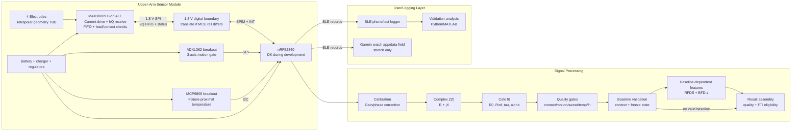

## 3.2. Planned Software Components and Ownership

These names define intended ownership boundaries used later in the FSM; they are not claims that implementations exist.

| Component | Owns | Must not own |
| --------- | ---- | ------------ |
| `safety_state_service` | Charger detection, allowed profile/current check, watchdog/timeouts, fail-safe stop. | Hydration interpretation. |
| `max30009_driver` | SPI register access, status/FIFO decoding, supported-setting mapping. | Sweep policy, calibration, scoring. |
| `bioz_sweep_service` | Repeated frequency sequence and sample/frequency association. | Raw register transport internals. |
| `context_sensor_service` | ADXL362 and MCP9808 configuration, channel identity, timestamped samples, and sensor-fault/staleness status. | Motion/temperature thresholds or hydration interpretation. |
| `calibration_service` | Versioned $C(f)$ application and calibration validity. | Baseline adaptation. |
| `bioz_feature_extractor` | Calibrated $Z(f)$ features, Cole fit, and post-baseline RFDS/BFD-z in `SCORE_FEATURES`. | Quality-policy thresholds or BLE framing. |
| `quality_gate_service` | Spectral, contact, motion, temperature, repeatability, fit, and saturation rules; heuristic Q. | Baseline mutation. |
| `baseline_service` | Context matching, eligibility, collection mode, freeze/hash, and validity. | Stage 3 adaptive updates. |
| `ble_hydration_service` | Stable serialization, fragmentation, `ASSEMBLE_RESULT`, and transmission status. | Recomputing scientific features. |
| `record_store` | Raw/processed/reject persistence, pending queue bounds, and lost-record counters. | Silently discarding rejected records. |
| `device_fsm` | §4.5.1 device states, button routing, build-time mode, sleep/shutdown entry. | Pipeline math or quality thresholds. |
| `led_indicator` | §4.5.3 priority arbitration and timer-driven patterns on the RGB LED. | Deciding device state. |
| `synthetic_validation` | §4.3.14 simulation backend, scenario table, truth comparison, timing/stack report. | Running in body-connected builds. |

`[UNVERIFIED — none of these component boundaries is implemented end to end; the firmware FSM under firmware/src/fsm/ is not yet reconciled with §4.5]` <!-- REVIEW 2026-11-14: Added device FSM, LED, and synthetic-validation components and replaced the stale bioz_fsm.h reference. --> <!-- REVIEW 2026-08-26: Added the missing §3.2 referenced throughout the FSM and aligned architecture ownership with the resolved state sequence. -->

---

## 4.1. Measurement Hardware

### 4.1.1. Selected AFE: MAX30009

The MAX30009 is the selected BioZ analog front end for the wearable prototype. The following capabilities are from the [MAX30009 Rev. 2 datasheet](https://www.analog.com/media/en/technical-documentation/data-sheets/MAX30009.pdf):

- simultaneous I/Q measurement,
- tetrapolar and bipolar configurations,
- programmable sine-wave stimulus,
- 20-bit ADCs with a tested ENOB of 16.3 bits at OSR = 128,
- guaranteed drive-frequency range of 0.016–500 kHz,
- high input impedance, lead/contact detection, and a 256-word FIFO,
- SPI and I²C interfaces,
- in-situ calibration support and frequency-dependent current limits.

<!-- REVIEW 2026-08-26: Added an inline primary-source link covering the grouped MAX30009 specifications. -->

**Design decision:** use 340 kHz as the MVP sweep ceiling. The datasheet mentions operation up to 806 kHz in descriptive text, but its guaranteed Electrical Characteristics table specifies a 500 kHz maximum drive frequency; this review therefore retains 500 kHz as the only design limit. <!-- REVIEW 2026-08-26: Preserved and made traceable the earlier correction from an 806 kHz assumed limit to the guaranteed 500 kHz specification. --> The EVKIT is used for early phantom validation before moving to the nRF52840-controlled path.

**Value decision:** the MAX30009 is selected as the best-fit AFE for this capstone. Its integrated BioZ stimulus/receive path, simultaneous I/Q acquisition, tetrapolar support, FIFO, and contact/status functions reduce custom analog design and firmware risk. The MAX30009EVKIT is the reference and bring-up platform; the final wearable direction uses the MAX30009 IC on a project PCB rather than packaging the complete EVKIT. <!-- REVIEW 2026-08-26: Identified the EVKIT as the selected development platform while preserving the development-versus-final-hardware boundary. -->

### 4.1.2. Selected MCU and Development Kit: nRF52840

The nRF52840 provides the planned BLE, SPI/TWI, USB, memory, and processing interfaces ([Nordic nRF52840 product page](https://www.nordicsemi.com/Products/nRF52840); [nRF52840 product specification](https://docs.nordicsemi.com/bundle/ps_nrf52840/page/keyfeatures_html5.html)):

- 64 MHz Arm Cortex-M4F,
- 1 MB flash and 256 kB RAM,
- Bluetooth Low Energy,
- SPI and I²C peripherals,
- USB full-speed and low-power modes.

<!-- REVIEW 2026-08-26: Added Nordic primary sources; used SPI/TWI terminology because Nordic's TWI peripheral implements the I²C-compatible role. -->

The [nRF52840 DK](https://www.nordicsemi.com/Products/Development-hardware/nRF52840-DK) exposes the SoC GPIOs and includes an onboard debugger and current-measurement access. Use one DK as the primary MAX30009/sensor integration target and the second as an independent BLE/replay development target and hardware spare. The DK is bench-development hardware, not the final wearable form factor, battery design, or body-connected safety boundary.

The project remains on nRF52840 for the MVP; validation quality takes priority over MCU migration. <!-- REVIEW 2026-08-26: Defined the roles of the two selected DKs and separated them from the final wearable design. -->

---

### 4.1.3. Digital Interface

**Design decision:** the MAX30009 shall be controlled from the nRF52840 over **SPI**. Both SPI and I²C are supported by the AFE ([MAX30009 datasheet](https://www.analog.com/media/en/technical-documentation/data-sheets/MAX30009.pdf)). <!-- REVIEW 2026-08-26: Separated interface capability from the project's interface choice. -->

The project selects SPI for:

- deterministic register transactions,
- reliable FIFO burst reads,
- better throughput margin,
- straightforward logic-analyzer debugging.

The throughput and reliability advantages are **design expectations**, not yet measured on this hardware; Gate 2 must verify them. I²C remains a documented fallback if external EVKIT wiring makes SPI unavailable. <!-- REVIEW 2026-08-26: Relabeled uncited performance claims as testable design expectations and added a fallback. -->

The MAX30009 digital interface shall be treated as a **1.8 V logic domain** ([MAX30009 datasheet](https://www.analog.com/media/en/technical-documentation/data-sheets/MAX30009.pdf); [ADI external-MCU SPI example](https://github.com/analogdevicesinc/MAX32655_MAX30009)). The actual GPIO voltage of the selected nRF52840 board shall be measured before connection. If it is not compatible with the verified sensor-board I/O rail, the interface shall use a fixed-direction, dual-supply digital translator rated for 1.8 V operation and the selected SPI rate. A generic open-drain I²C level shifter or unverified resistor-divider interface is not an acceptable substitute for the push-pull SPI signals.

The translated directions are fixed: `SCLK`, `SDI`, and `CSB` travel from the nRF52840 to the MAX30009; `SDO` and, when used, `INT` travel from the MAX30009 to the nRF52840. `FCLK` is not driven by the nRF52840 unless the frozen clock profile and the EVKIT schematic explicitly require it. <!-- REVIEW 2026-08-26: Added the previously missing voltage-domain and signal-direction contract. -->

---

### 4.1.4. MAX30009EVKIT Use

The MAX30009EVKIT supports GUI-based configuration, live viewing, data logging, and SPI-to-BLE transport to a PC ([MAX30009EVKIT guide](https://www.analog.com/media/en/technical-documentation/data-sheets/max30009evkit-evk-rev2.pdf)). The kit consists of a `MAXSENSORBLE_EVKIT_B` controller board and a `MAX30009_EVKIT_B` sensor board joined by a flex cable. The supplied controller is the SPI master in the stock configuration; the nRF52840 path replaces that controller-side function rather than becoming a second simultaneous master. <!-- REVIEW 2026-08-26: Made the two-board topology and single-master rule explicit. -->

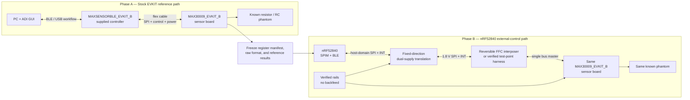

It shall be used in three phases:

1. **EVKIT GUI validation**
   - Keep the supplied controller and sensor boards in their documented stock configuration.
   - Confirm known resistor and RC phantom readings.
   - Export/log raw or processed data.
   - Record the complete GUI/register profile, frequency/current units, and raw-data interpretation used for each reference run.
   - Capture SPI traffic nonintrusively if accessible test points permit it.

2. **External nRF52840 control**
   - Power down before disconnecting the supplied controller or inserting an interposer.
   - Use a reversible FFC breakout/interposer or verified test-point harness; do not cut traces or irreversibly modify the only working EVKIT.
   - Establish exactly one SPI master, one power source per rail, a common reference ground, and verified 1.8 V logic before enabling either board.
   - Use SPI for register access and FIFO reads, initially on phantoms only.
   - Validate register read/write, FIFO decoding, actual frequency/current settings, and known-load agreement against the stock path.
   - **Failure branch:** if external control is not practical by the end of Week 8, retain the EVKIT GUI/export path for Stage 1 and use a separate MAX30009 breakout/custom interface for later MCU integration.

3. **Wearable prototype transition**
   - Move from EVKIT wiring to wearable mechanical/electrode validation only after phantom performance and repeatability procedures are understood.
   - Replace the EVKIT/interposer assembly with a project PCB containing the MAX30009, verified protection network, power system, and nRF52840 interface.

The ADI external-MCU example is a useful implementation reference, but its README contains a contradictory `J7` instruction and its capacitor changes are tied to its own bipolar wrist/GSR setup. Jumper positions, flex-pin assignments, and component changes shall therefore be resolved from the exact EVKIT schematic and physical board revision, not copied from that README into this tetrapolar 1–340 kHz design. <!-- REVIEW 2026-08-26: Added the source-specific ambiguity and prevented unrelated GSR hardware changes from becoming requirements. -->

**Sequencing decision:** a custom PCB shall not be prioritized until the stock and nRF-controlled phantom paths agree and electrode repeatability is understood.

---

### 4.1.5. nRF52840-to-MAX30009 Electrical Handoff

The table defines **logical connections**, not connector pin numbers. Physical pins remain `[UNVERIFIED — exact MAX30009EVKIT board revision, flex pitch/orientation, and schematic net mapping must be checked on the received hardware]`.

| nRF52840 side | MAX30009 / sensor-board net | Direction relative to nRF52840 | Integration requirement |
| ------------- | --------------------------- | ------------------------------ | ----------------------- |
| SPIM `SCK` | `SCLK/SCL` | Output | Translate to the verified 1.8 V domain; begin at 1 MHz. |
| SPIM `MOSI` | `SDI/SDA` | Output | Translate to 1.8 V; keep stable around the selected sampling edge. |
| SPIM `MISO` | `SDO/ADDR` | Input | Translate from 1.8 V; do not allow contention with the supplied controller. |
| GPIO chip select | `CSB/I2C_SEL` | Output | Hold low during power-up/interface selection to select SPI; after initialization, drive high between transactions and low for one complete command or FIFO burst. |
| GPIO interrupt | `INT` | Input | Optional during initial polling bring-up; translate and configure polarity/pull from the frozen register profile before use. |
| Optional clock output | `FCLK` | Output | Normally leave the documented sensor-board clock network intact; connect only if the selected clock mode requires it. |
| Ground | `GND` | Common | Bond grounds before enabling translated digital signals. |
| Verified supply | `VDD/1V8` path | Power | Determine whether the received sensor board is fed through the flex or locally; use exactly one source and prevent back-powering. |

For bench integration with an nRF52840 development kit, assume level translation is required until both I/O rails are measured and proven compatible. For the final project PCB, either power the nRF52840 I/O domain at a MAX30009-compatible voltage after a complete power/peripheral review or retain a fixed-direction translator. The interposer is a development fixture, not part of the intended wearable. The nRF52840 shall never connect directly to the analog electrode nets `DRVP`, `DRVN`, `BIP`, or `BIN`; those remain within the MAX30009 protection/electrode domain.

The interposer or harness shall:

1. match the received connector pitch, contact orientation, and pin numbering,
2. expose labeled test points for power, ground, `CSB`, `SCLK`, `SDI`, `SDO`, and `INT`,
3. provide an explicit disconnect between the supplied MCU and the sensor-board bus plus the reviewed pull/control state needed to hold `CSB/I2C_SEL` low during SPI selection,
4. provide unambiguous power-source selection and no-backfeed behavior,
5. keep digital wiring short and provide optional series-damping footprints if signal-integrity testing requires them,
6. preserve the stock flex cable and permit restoration of the original EVKIT configuration.

Before the first powered nRF52840 connection:

1. Photograph and record both EVKIT board revisions.
2. Trace every proposed flex/test-point net against the schematic and verify continuity with power removed.
3. Measure the nRF GPIO rail, sensor-board digital rail, and translator rails independently.
4. Confirm that the supplied controller is disconnected from `CSB`, `SCLK`, `SDI`, and `SDO`.
5. Power the sensor side with all nRF outputs high-impedance except the reviewed `CSB/I2C_SEL` low selection state; check for unexpected current or back-powered rails.
6. After SPI selection, configure `CSB` high between transactions, enable SPIM, and set `DISABLE_I2C=1` during the reviewed initialization sequence as specified by the datasheet.
7. Perform the status/part-ID and read-modify-readback checks in §4.6 before enabling BioZ drive.

USB/J-Link debugging is permitted only for disconnected electronics or phantom testing. Any body-connected measurement shall be battery powered with USB, debugger, and charger paths physically disconnected or isolated and approved under §4.10; BLE or local storage shall carry the data. <!-- REVIEW 2026-08-26: Added a concrete, reversible hardware integration and pre-power checklist without inventing board-revision pin numbers. -->

---

### 4.1.6. Selected Auxiliary Sensors: ADXL362 (Motion) and MCP9808 (Temperature)

The ADXL362 and MCP9808 are the selected auxiliary sensors supporting the quality-gating pipeline in §4.4: one ADXL362 breakout provides the three-axis motion signal for the stillness/motion gate (§4.4.3), and one MCP9808 breakout provides the fixture-proximal temperature channel for the temperature gate (§4.4.4). Ambient temperature is not a device channel; room temperature is recorded manually as session context (§4.9.1). <!-- REVIEW 2026-11-14: Reduced the design to the single MCP9808 actually on the bench and removed the device ambient channel. --> Both are used as commercial breakout boards during development, consistent with the MAX30009EVKIT approach in §4.1.4; neither has an assigned final-PCB footprint yet.

**ADXL362 (SparkFun breakout, SPI).** The following are from Table 1 (Specifications) of the [ADXL362 Rev. G datasheet](https://www.analog.com/media/en/technical-documentation/data-sheets/adxl362.pdf), at TA = 25°C, VS = 2.0 V unless noted:

- measurement range: user-selectable ±2 g, ±4 g, or ±8 g,
- output resolution: 12-bit per axis (8-bit MSB-only reads also available),
- sensitivity: 1 mg/LSB (±2 g range), 2 mg/LSB (±4 g range), 4.255 mg/LSB (±8 g range),
- sensitivity calibration error: ±10% (guaranteed maximum, uncalibrated part),
- sensitivity change with temperature: 0.05%/°C over −40°C to +85°C,
- 0 g offset: ±150 mg (X, Y axes), ±250 mg (Z axis),
- 0 g offset vs. temperature: ±0.5 mg/°C (X, Y, normal operation), ±0.6 mg/°C (Z, normal operation), ±0.35 mg/°C (X, Y, Z in low-noise or ultralow-noise mode),
- nonlinearity: ±0.5% of full scale; cross-axis sensitivity: ±1.5%,
- noise density at VS = 2.0 V: 550 µg/√Hz (X, Y) / 920 µg/√Hz (Z) in normal operation, improving to 250 µg/√Hz (X, Y) / 350 µg/√Hz (Z) in ultralow-noise mode (lower still at VS = 3.5 V),
- output data rate: user-selectable 12.5 Hz to 400 Hz,
- operating voltage: 1.6 V to 3.5 V (VS and VDD I/O); operating temperature range: −40°C to +85°C.

**Design decision:** operate the ADXL362 in the ±2 g range at 1 mg/LSB; the stillness/motion gate in §4.4.3 needs sub-g resolution near 0 g, not the wider ±8 g range used for shock detection. `[UNVERIFIED — SparkFun breakout revision, exact routed net names, and any onboard voltage regulation must still be confirmed against the physical board]`. <!-- REVIEW 2026-08-30: Added the datasheet Table 1 specification block backing the previously text-only ADXL362 references. -->

**MCP9808 (Adafruit breakout, I²C).** The following are from the [MCP9808 datasheet](https://www.microchip.com/en-us/product/mcp9808) (Microchip DS20005095):

- accuracy: ±0.25°C typical from −40°C to +125°C; ±0.5°C maximum from −20°C to +100°C; ±1°C maximum over the full −40°C to +125°C range,
- resolution: user-selectable 0.5°C, 0.25°C, 0.125°C, or 0.0625°C,
- operating voltage: 2.7 V to 5.5 V; operating current: 200 µA typical (continuous conversion), 0.1 µA typical in shutdown,
- interface: I²C/SMBus-compatible, standard/fast mode; three address pins support up to eight devices on one bus.

**Design decision:** configure the channel at the finest 0.0625°C resolution step. This improves reported precision but does not change the sensor's ±0.25°C (typical) / ±0.5°C (maximum, −20°C to +100°C) absolute accuracy — resolution and accuracy are different datasheet parameters and should not be conflated when interpreting §4.4.4's temperature-gate bands. `[UNVERIFIED — Adafruit breakout revision and onboard pull-up values must still be confirmed against the physical boards]`. <!-- REVIEW 2026-08-30: Added the datasheet accuracy/resolution specification block backing the previously text-only MCP9808 references. -->

---

## 4.2. Electrode Geometry — Pending Final Decision

This is the one design area intentionally left open. The system requires tetrapolar upper-arm BioZ measurement, but the final physical electrode geometry shall be selected after early repeatability and artifact testing.

The final geometry must satisfy:

1. repeatable placement,
2. acceptable contact quality,
3. low sensitivity to strap pressure,
4. low sensitivity to sweat bridging,
5. low motion artifact during stillness-gated readings,
6. compatibility with upper-arm wearable form factor,
7. clear documentation for validation and review.

---

### 4.2.1. Candidate Geometry A — Cross-Arm Tetrapolar

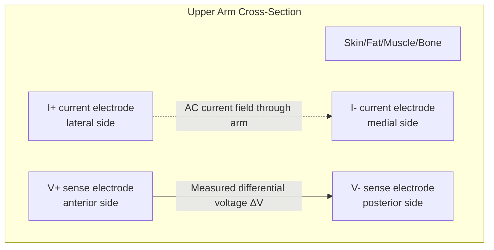

Candidate advantages:

- a published finite-element and human study found that its cross-arm arrangement drove current through more of the brachium than its same-side arrangement,
- may reduce dependence on superficial same-side conduction,
- directly matches a recent arm-worn BioZ hydration precedent ([Jankovic et al., 2025](https://pmc.ncbi.nlm.nih.gov/articles/PMC12304993/)),
- mechanically plausible for an upper-arm strap.

<!-- REVIEW 2026-08-26: Replaced the uncited geometry advantages with the directly demonstrated findings and retained mechanical plausibility as a project judgment. -->

Candidate risks:

- harder strap mechanics,
- harder angular placement repeatability,
- possible pressure imbalance around the arm,
- more difficult electrode routing.

---

### 4.2.2. Candidate Geometry B — Same-Side Longitudinal Tetrapolar Strip

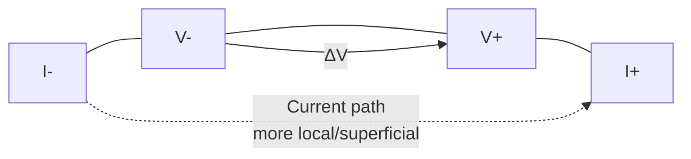

Candidate advantages:

- easier to prototype,
- easier to fixture,
- simpler wiring,
- easier to compare repeated placements.

Candidate risks:

- the published comparison produced a more local/superficial current path,
- the same-side arrangement showed little reactance change and a less interpretable hydration trajectory in that study ([Jankovic et al., 2025](https://pmc.ncbi.nlm.nih.gov/articles/PMC12304993/)),
- more sensitive to local tissue geometry and sweat bridging.

The sweat-bridging comparison between these two candidate geometries is `[UNVERIFIED — not reported by the cited arm-worn study and not yet tested here]`. <!-- REVIEW 2026-08-26: Sourced the same-side limitation and flagged the remaining geometry-specific sweat claim. -->

---

### 4.2.3. Geometry Selection Test

The final geometry shall be selected using a controlled test before the fluid-loss pilot. All numerical limits below are **provisional project assumptions**, not published performance guarantees; Stage 0 must freeze them and Stage 2 must measure them. <!-- REVIEW 2026-08-26: Removed the optimistic “short” qualifier and labeled unsourced thresholds. -->

Minimum comparison:

| Metric                       | Requirement                                                              |
| ---------------------------- | ------------------------------------------------------------------------ |
| Phantom compatibility        | Geometry can be tested with known loads or equivalent fixture.           |
| Within-session repeatability | R₀ CV target <3%, maximum <5%.                                           |
| Reattachment repeatability   | R₀ difference target <5%, maximum <10%.                                  |
| Sweat vulnerability          | No obvious bridging or spectral collapse under light moisture challenge. |
| Motion/stillness sensitivity | Stable during seated stillness; rejects movement properly.               |
| User fit                     | Wearable on upper arm without extreme placement burden.                  |

The selected geometry shall be documented with:

- electrode spacing,
- angular placement,
- electrode material,
- strap pressure method,
- placement photos,
- repeatability data,
- final rationale.

---

### 4.2.4. Electrode Placement Rules

Regardless of final geometry:

The following are **project protocol rules**. Mid-upper-arm placement is consistent with the brachium precedent, while the exact landmarks, spacing, pressure, and settling time remain to be validated for this fixture ([Jankovic et al., 2025](https://pmc.ncbi.nlm.nih.gov/articles/PMC12304993/)). <!-- REVIEW 2026-08-26: Distinguished sourced anatomical precedent from project-specific placement rules. -->

1. Place electrodes at mid-upper arm, away from shoulder and elbow transition zones.
2. Use repeatable angular positioning around the arm.
3. Use strap alignment marks.
4. Photograph placement during validation.
5. Record arm circumference.
6. Control strap pressure.
7. Use gel Ag/AgCl electrodes first.
8. Validate dry electrodes separately.
9. Do not claim dry-electrode performance from gel-electrode data.

---

## 4.3. Math From AFE to Fluid-Trend Output

This is the core of the design. If this section becomes hand-wavy, the project is not ready for review.

### 4.3.0. Circuit Intuition and Processing Order

The simplified tissue model can be read as a two-branch circuit:

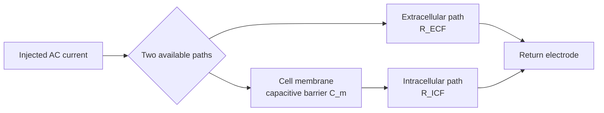

- At low frequency, the membrane capacitance has high reactance, so the intracellular branch contributes little. The Cole-model low-frequency intercept $R_0$ is therefore treated as extracellular-fluid-dominant.
- At high frequency, membrane reactance falls and the intracellular branch contributes. The high-frequency intercept is therefore modeled as $R_\infty=R_{ECF}\parallel R_{ICF}$.
- $R_0$ and $R_\infty$ are fitted intercepts, not direct readings at 1 kHz and 340 kHz. The Cole model describes the transition between them across the measured sweep.

This is a simplified equivalent-circuit interpretation, not a literal anatomical separation of current paths ([Brantlov et al., 2025](https://pmc.ncbi.nlm.nih.gov/articles/PMC12299080/); [Jankovic et al., 2025](https://pmc.ncbi.nlm.nih.gov/articles/PMC12304993/)). <!-- REVIEW 2026-08-26: Replaced blocked publisher links with open full text supporting the frequency-dependent interpretation and model limitation. -->

The implementation shall preserve this processing order:

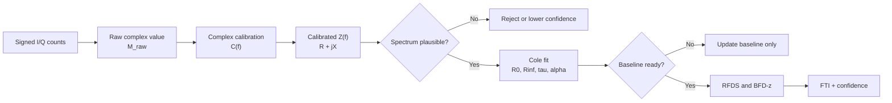

---

### 4.3.1. Frequency Sweep

**Design decision:** the MVP shall initially measure at:

$$
f_k \in \{1,2,5,10,20,50,100,200,340\}\text{ kHz}
$$

**Provisional assumption:** the validation sweep will use 24 logarithmically spaced points:

$$
f_k = \text{logspace}(1\text{ kHz},340\text{ kHz},24)
$$

The 340 kHz cap is 160 kHz below the MAX30009's guaranteed 500 kHz maximum drive frequency ([MAX30009 datasheet](https://www.analog.com/media/en/technical-documentation/data-sheets/MAX30009.pdf)). The datasheet also mentions 806 kHz in descriptive prose, but this plan uses only the guaranteed Electrical Characteristics limit. <!-- REVIEW 2026-08-26: Replaced appendix-only citation notation with the primary link and clarified that “headroom” is arithmetic, not a performance guarantee. -->

**Engineering inference to test:** because $R_\infty$ is extrapolated beyond the measured band, a 340 kHz ceiling may make $R_\infty$ and $R_{ICF}$ poorly identifiable. The 24-point count, frequency list, and ability to recover all four Cole parameters are `[UNVERIFIED — pending Stage 1 phantom profile-likelihood or equivalent identifiability analysis]`. If Stage 1 recovery is poor, extend toward 500 kHz or disable $R_\infty$/$R_{ICF}$ outputs; do not plan around 806 kHz. <!-- REVIEW 2026-08-26: Relabeled an uncited extrapolation claim as a falsifiable design hypothesis and added the disable-output failure branch. -->

---

### 4.3.2. Raw I/Q Acquisition

At each frequency $f_k$, MAX30009 returns in-phase (I) and quadrature (Q) samples, two orthogonal components that encode amplitude and phase ([MAX30009 datasheet](https://www.analog.com/media/en/technical-documentation/data-sheets/MAX30009.pdf)). <!-- REVIEW 2026-08-26: Added a plain-language first-use explanation and primary citation. -->

$$
ADC_I(f_k), \quad ADC_Q(f_k)
$$

Convert raw samples into signed values:

$$
I_{cnt}(f_k)=signextend(ADC_I(f_k))
$$

$$
Q_{cnt}(f_k)=signextend(ADC_Q(f_k))
$$

Optional offset correction:

$$
I'_{cnt}(f_k)=I_{cnt}(f_k)-I_{offset}(f_k)
$$

$$
Q'_{cnt}(f_k)=Q_{cnt}(f_k)-Q_{offset}(f_k)
$$

Construct the raw complex measurement:

$$
M_{raw}(f_k)=I'_{cnt}(f_k)+jQ'_{cnt}(f_k)
$$

The sign extension, FIFO word order, I/Q association, and phase sign are **implementation assumptions until verified with a resistor and capacitive RC phantom**. A mismatch is a Gate 2 hard failure, not a calibration coefficient to hide later. <!-- REVIEW 2026-08-26: Added the missing raw-decoding failure mode. -->

---

### 4.3.3. Raw Complex Voltage

The exact ADC scale depends on MAX30009 configuration, receive gain, filters, and register settings ([MAX30009 datasheet](https://www.analog.com/media/en/technical-documentation/data-sheets/MAX30009.pdf)). Firmware shall represent this as a versioned configured voltage scale: <!-- REVIEW 2026-08-26: Added the source and a configuration-version dependency. -->

$$
V_{raw}(f_k)=M_{raw}(f_k)\cdot K_V(f_k)
$$

where $K_V(f_k)$ includes:

- ADC LSB size,
- receive-path gain,
- decimation/filter scaling,
- firmware unit conversion.

If this constant is not fully verified during early bring-up, calibration may map raw complex counts directly to impedance.

---

### 4.3.4. Raw Complex Impedance

For a programmed RMS current drive:

$$
I_{DRV}(f_k)
$$

the raw impedance estimate is:

$$
Z_{raw}(f_k)=\frac{V_{raw}(f_k)}{I_{DRV}(f_k)}
$$

If calibration maps counts directly to impedance, use:

$$
Z_{raw}(f_k)=M_{raw}(f_k)\cdot K_Z(f_k)
$$

where $K_Z(f_k)$ is a complex per-frequency scale factor.

---

### 4.3.5. Per-Frequency Complex Calibration

**Calibration-model assumption:** over the selected range and fixed register profile, the dominant system error can be represented by a linear, multiplicative complex coefficient at each frequency. Offset, nonlinearity, clipping, time drift, and load-dependent electrode effects are not corrected by this equation and must be tested separately. <!-- REVIEW 2026-08-26: Made the previously hidden limitation of one-point complex calibration explicit. -->

Measure a known calibration impedance:

$$
Z_{cal,true}(f_k)
$$

and the raw measured value:

$$
Z_{cal,raw}(f_k)
$$

Compute complex calibration coefficient:

$$
C(f_k)=\frac{Z_{cal,true}(f_k)}{Z_{cal,raw}(f_k)}
$$

Apply it to future measurements:

$$
Z(f_k)=C(f_k)\cdot Z_{raw}(f_k)
$$

This corrects both magnitude and phase:

$$
C(f_k)=|C(f_k)|e^{j\phi_C(f_k)}
$$

**Project minimum calibration set:**

1. precision resistor near expected tissue impedance,
2. second resistor at lower/higher range,
3. RC phantom,
4. open/short parasitic characterization,
5. repeat calibration after temperature change if required by data.

Calibration is mandatory for reported impedance accuracy. If coefficients fail to improve held-aside phantom loads, invalidate the calibration version and do not report calibrated Cole features. <!-- REVIEW 2026-08-26: Replaced qualitative wording with an executable acceptance/failure rule. -->

---

### 4.3.6. Complex Impedance Features

For each calibrated frequency:

$$
Z(f_k)=R(f_k)+jX(f_k)
$$

$$
R(f_k)=\Re\{Z(f_k)\}
$$

$$
X(f_k)=\Im\{Z(f_k)\}
$$

$$
|Z(f_k)|=\sqrt{R(f_k)^2+X(f_k)^2}
$$

$$
\\theta(f_k)=\operatorname{atan2}\left(X(f_k),R(f_k)\right)
$$

At or near 50 kHz:

$$
R_{50}=R(50\text{ kHz})
$$

$$
X_{50}=X(50\text{ kHz})
$$

$$
\\theta_{50}=\operatorname{atan2}\left(X_{50},R_{50}\right)
$$

`atan2` is required in code because it preserves the signs of both $R$ and $X$ and therefore returns the correct quadrant. Under the conventional $Z=R+jX$ definition, capacitive tissue has $R>0$ and $X<0$, so phase is negative; firmware shall not assume the MAX30009's raw Q polarity implements that convention until an RC phantom confirms it. <!-- REVIEW 2026-08-26: Preserved the mathematical fact but added the device-sign validation dependency. -->

Use 50 kHz as a comparison point for phase and related features; the final feature set remains subject to phantom and repeatability results.

---

### 4.3.7. Cole Model Fit

**Model choice:** use the single-dispersion Cole model, a commonly used equivalent-circuit approximation for biological impedance, subject to the limitations of fitting any equivalent circuit to living tissue ([Brantlov et al., 2025](https://pmc.ncbi.nlm.nih.gov/articles/PMC12299080/); [Iftime et al., 2025](https://doi.org/10.3390/bioengineering12090926)). Note that publications use different $\alpha$ exponent conventions; this document uses $(1-\alpha)$ and tests must not mix conventions. <!-- REVIEW 2026-08-26: Replaced a blocked source with open full text and made the exponent-convention risk explicit. -->

$$
Z(\omega)=R_{\infty}+\frac{R_0-R_{\infty}}{1+(j\omega\tau)^{1-\alpha}}
$$

where:

$$
\omega=2\pi f
$$

| Parameter    | Meaning                                 |
| ------------ | --------------------------------------- |
| $R_0$        | Extrapolated low-frequency resistance.  |
| $R_{\infty}$ | Extrapolated high-frequency resistance. |
| $\tau$       | Time constant.                          |
| $\alpha$     | Dispersion broadening factor.           |

The limiting cases provide a cheap implementation check:

$$
\lim_{\omega\to0}Z(\omega)=R_0,
\qquad
\lim_{\omega\to\infty}Z(\omega)=R_\infty
$$

The model is useful because it converts a curved impedance spectrum into two circuit intercepts and two shape parameters. It does not by itself prove hydration status; the baseline comparison and validation stages provide that interpretation.

Fit by bounded nonlinear least squares:

$$
\min_{R_0,R_{\infty},\tau,\alpha}\sum_{k=1}^{N}\left|Z_{meas}(f_k)-Z_{model}(f_k)\right|^2
$$

**Provisional numerical bounds:**

$$
R_0 > R_{\infty} > 0
$$

$$
0 \le \alpha \le 0.5
$$

$$
\tau > 0
$$

The $\alpha$ range corresponds algebraically to a dispersion exponent $(1-\alpha)\in[0.5,1.0]$, but the $0\le\alpha\le0.5$ bound is a **project assumption**, not a verified population range. Confirm the exponent convention in code before fitting recorded data. <!-- REVIEW 2026-08-26: Relabeled the unsourced alpha bound. -->

Fit residual:

$$
E_{fit}=
\frac{
\sqrt{\frac{1}{N}\sum_{k=1}^{N}|Z_{meas}(f_k)-Z_{model}(f_k)|^2}
}{
R_0-R_{\infty}
}
$$

**Provisional gate:** reject or downgrade if:

$$
E_{fit} > 0.05
$$

The 0.05 threshold, equal weighting of real/imaginary residuals, and normalization by $R_0-R_\infty$ are project choices. Reject the fit outright if a parameter is pinned to a bound, if $R_0-R_\infty$ is smaller than its validated uncertainty floor, or if repeated starting points converge to materially different solutions. Tune the residual threshold using phantom/repeatability data and freeze it before Stage 3. <!-- REVIEW 2026-08-26: Labeled the threshold and objective assumptions and added failure behavior for bound hits and non-identifiability. -->

---

### 4.3.8. Derived Intracellular Resistance

Under the simplified parallel interpretation, in which the low-frequency current path is extracellular and the high-frequency path adds the intracellular route across the cell membrane ([Brantlov et al., 2025](https://pmc.ncbi.nlm.nih.gov/articles/PMC12299080/)):

$$
R_0 = R_{ECF}
$$

$$
R_{\infty}=R_{ECF}\parallel R_{ICF}
$$

Therefore:

$$
\frac{1}{R_{\infty}}=\frac{1}{R_0}+\frac{1}{R_{ICF}}
$$

$$
R_{ICF}=\frac{R_0R_{\infty}}{R_0-R_{\infty}}
$$

This derived value is useful for research analysis but shall not be over-explained in the user interface.

The implementation shall report $R_{ICF}$ as unavailable if $R_0\le R_\infty$ or if $R_0-R_\infty$ is too small relative to the validated fit uncertainty. The formula becomes ill-conditioned as the denominator approaches zero; this is a model/fit failure, not evidence of extremely large intracellular resistance.

The cited paper supports the simplified resistance relation. Separately, the local deterministic sensitivity check in [bioz_pipeline_check.py](bioz_pipeline_check.py) assumes a 2 ns fixed delay and produces −1.0609% $R_\infty$ bias, approximately 4.5 Ω $R_{ICF}$ error, and +0.0134% $R_0$ bias at this synthetic parameter set. The 2 ns value is **illustrative, not a measured board delay or a literature result**. Measure $T_d$ with calibration fixtures and treat $R_0$-based RFDS as primary until correction is validated. <!-- REVIEW 2026-08-26: Correctly attributed the numerical delay result to the executable local analysis and exposed its assumed input. -->

---

### 4.3.9. Primary Internal Metric — RFDS

The main internal single-feature metric is the project-defined **Relative Fluid Deficit Signal (RFDS)**. It is not a published clinical hydration scale. <!-- REVIEW 2026-08-26: Identified RFDS as a project-defined metric rather than an established biomarker. -->

$$
RFDS=
\frac{
R_{0,current}-R_{0,baseline}
}{
R_{0,baseline}
}
\times100\%
$$

Interpretation:

| RFDS     | Internal Meaning                                                                                                        |
| -------- | ----------------------------------------------------------------------------------------------------------------------- |
| Negative | R₀ lower than baseline. Could reflect increased conductivity, temperature/perfusion effect, fluid loading, or artifact. |
| Near 0   | Near personal baseline.                                                                                                 |
| Positive | R₀ higher than baseline. Could indicate reduced tissue fluid signal, but may also reflect artifact.                     |

RFDS is a fitted BioZ-feature change, not a directly measured fluid deficit or an absolute hydration estimate. It is valid only when the stored baseline matches arm, geometry, electrode type, register/calibration profile, and approved temperature context. If $R_{0,baseline}$ is unavailable, nonpositive, stale, or outside its validated context, RFDS is unavailable. <!-- REVIEW 2026-08-26: Corrected “measured” to “fitted” and added baseline validity failures. -->

---

### 4.3.10. Primary Algorithmic Metric — BFD-z

The primary algorithmic trend metric is the project-defined **BFD-z**, a signed regularized Mahalanobis distance from the user's baseline. Despite its name, it is not a standard-normal z-score and values such as 1, 2, and 3 do not inherit ordinary z-score probabilities. <!-- REVIEW 2026-08-26: Corrected a potentially misleading statistical interpretation. -->

Define feature vector:

$$
\mathbf{x}=
\begin{bmatrix}
\Delta R_0\% \\
\Delta R_{50}\% \\
\Delta X_{50}\% \\
\Delta \theta_{50} \\
\Delta R_{\infty}\%
\end{bmatrix}
$$

where each percent change is relative to baseline.

Store the baseline mean:

$$
\boldsymbol{\mu}_{base}
$$

and covariance:

$$
\Sigma_{base}
$$

The direct inverse $\Sigma_{base}^{-1}$ is not acceptable for the MVP because the five features are correlated and a short baseline can be singular or nearly singular. Standardize each feature first:

$$
\mathbf{z}=S^{-1}(\mathbf{x}-\boldsymbol{\mu}_{base}),
\qquad
S=\operatorname{diag}(s_1,\ldots,s_5)
$$

where each $s_i$ is the larger of the observed baseline standard deviation and a nonzero feature floor established from phantom/repeatability data. Form the scaled covariance matrix and apply shrinkage:

$$
R=S^{-1}\Sigma_{base}S^{-1}
$$

$$
R_\lambda=(1-\lambda)R+\lambda I,
\qquad 0<\lambda\le1
$$

Compute the regularized Mahalanobis distance:

$$
D_M=
\sqrt{
\mathbf{z}^T R_\lambda^{-1}\mathbf{z}
}
$$

Because $R$ is positive semidefinite and $\lambda>0$, $R_\lambda$ is positive definite and invertible. It is not necessarily a correlation matrix when a feature floor exceeds the observed standard deviation. The exact $\lambda$ and feature floors shall be fixed using baseline replay data; until then, BFD-z is `[UNVERIFIED — not tuned or validated on human baselines]`. The 2026-08-26 execution of [bioz_pipeline_check.py](bioz_pipeline_check.py) produced condition number $1.82\times10^9$ for one synthetic, deliberately correlated 10-session baseline; that value does not estimate the future human dataset's condition number. <!-- REVIEW 2026-08-26: Corrected “correlation matrix,” retained the invertibility argument, and scoped the reproduced condition number to its synthetic data. -->

Assign sign using RFDS:

$$
BFD_z=sign(RFDS)\cdot D_M
$$

Interpretation:

- $BFD_z \approx 0$: normal baseline variation,
- $BFD_z > 0$: low-fluid-direction BioZ shift,
- $BFD_z < 0$: high-conductivity-direction BioZ shift,
- large magnitude: unusual BioZ state or artifact.

**Design rationale:** BFD-z combines multiple BioZ features and personal variability, but its added value over RFDS is `[UNVERIFIED — must beat an RFDS-only baseline in participant-held-out validation]`. <!-- REVIEW 2026-08-26: Replaced advocacy with a falsifiable model-comparison requirement. -->

---

### 4.3.11. Optional Validated Estimate — Percent Body Mass Loss

**STRETCH — NOT MVP:** after Stage 3, the team may fit the following as an exploratory model, but it shall not become a user-facing estimate unless a frozen version passes Stage 5 independent validation:

$$
\widehat{BML\%}=\beta_0+\beta_1RFDS+\beta_2BFD_z+\beta_3\Delta\theta_{50}+\beta_4\Delta T_{fixture}+\epsilon
$$

Report with uncertainty:

$$
\widehat{BML\%}\pm PI_{95}
$$

User-facing example:

> Estimated workout fluid loss: 1.3% body mass  
> Confidence: Medium  
> Prediction interval: 0.7–1.9%

The $\Delta T_{fixture}$ term is a learned predictor, not an invented temperature correction to BioZ; room temperature from the manual session log remains context unless a frozen model independently justifies another term. The numeric example is illustrative only and is `[UNVERIFIED — no trained model or prediction interval exists]`. <!-- REVIEW 2026-08-26: Bound the exploratory temperature predictor to the selected fixture-proximal channel while retaining ambient context. -->

---

### 4.3.12. User-Facing Fluid Trend Indicator

The user-facing output shall be categorical, not falsely precise. Evaluate hard quality failures first, then $Q<40$, then the remaining rows from most severe to least severe.

| Condition | Display |
| --------- | ------- |
| Quality failed | “Reading skipped — adjust sensor / stay still.” |
| $Q<40$ | “Fluid trend uncertain — recheck seated.” |
| $BFD_z\ge3$ or $RFDS>8\%$ | “BioZ Fluid Trend: Very low vs baseline — recheck.” |
| $BFD_z\ge2$ or $4\%\le RFDS\le8\%$ | “BioZ Fluid Trend: Low vs baseline.” |
| $BFD_z\ge1$ or $2\%\le RFDS<4\%$ | “BioZ Fluid Trend: Slightly low vs baseline.” |
| $BFD_z\le-1$ or $RFDS\le-2\%$ | “Fluid signal above baseline — may reflect fluid intake, temperature, salt, or vascular change.” |
| $\lvert BFD_z\rvert<1$ and $\lvert RFDS\rvert<2\%$ | “BioZ Fluid Trend: Baseline.” |

All numerical thresholds and category wording are **provisional project assumptions**, not clinical cutoffs or standard z-score bands. The table is an ordered cascade; hard failures and low Q take precedence. Freeze the full mapping before Stage 3 and revise it only under a dated amendment using Stage 2 noise or data held out from threshold selection. <!-- REVIEW 2026-08-26: Made threshold provenance explicit and prevented post-outcome tuning. -->

The provisional RFDS = 4.0% boundary is closed on the “Low” side to match the executable helper. This resolves the prior gap at exactly 4.0%; it does not validate 4.0% physiologically. The added $RFDS\le-2\%$ branch also closes a previous unmapped region where $-1<BFD_z<1$ and RFDS was substantially negative. <!-- REVIEW 2026-08-26: Resolved two categorical coverage defects and aligned the document with the executed helper before data collection. -->

### 4.3.13. Executed Mathematical Verification

The local Python verification, [bioz_pipeline_check.py](bioz_pipeline_check.py), was executed on 2026-08-26 using a synthetic Cole spectrum with $R_0=180\ \Omega$, $R_\infty=95\ \Omega$, $\tau=8\times10^{-7}\text{ s}$, and $\alpha=0.08$ over the 24-point 1–340 kHz validation sweep. These assumed values are plausible test inputs, not measured upper-arm reference values. The checks verify implementation consistency only, not AFE accuracy or hydration validity in people. <!-- REVIEW 2026-08-26: Linked and dated the reproducible evidence and labeled its synthetic inputs. -->

| Check | Executed Result | Status |
| ----- | --------------- | ------ |
| Cole asymptotes | $Z(1\text{ Hz})=179.9999-j0.0011\ \Omega$; $Z(1\text{ GHz})=95.0042-j0.0332\ \Omega$ | Pass |
| Noiseless bounded Cole fit | All four parameters recovered with displayed error 0.00000%; $E_{fit}=2.31\times10^{-16}$ | Pass |
| ENOB = 16.3 quantisation case | $R_0$ error 0.00011%; $R_\infty$ error 0.00411%; $E_{fit}=2.81\times10^{-5}$ | Pass |
| Parallel-resistance algebra | $1/R_\infty-1/R_0=1/R_{ICF}=0.004971\ \Omega^{-1}$ | Pass |
| RFDS +4% case | Recovered RFDS = +4.000% | Pass |
| Regularized BFD-z | Baseline check −0.562; +4% $R_0$ case +1.828; zero and near-singular covariance cases finite | Pass; tuning not yet validated |
| $T_d=2$ ns sensitivity | $R_0$ bias +0.0134%; $R_\infty$ bias −1.0609%; $R_{ICF}$ error 4.5 Ω | Pass; confirms correction need |
| Raw covariance inverse | Condition number $1.82\times10^9$ | Fail; use regularized form in §4.3.10 |
| Human hydration interpretation | No human dataset was executed in this check | **UNVERIFIED — NOT EXECUTED** |

The ENOB case models idealized quantization noise only; it omits AFE noise, current-source error, electrode noise, coupling, drift, and model mismatch. Therefore the script does **not** establish that quantization is unimportant in the real system. <!-- REVIEW 2026-08-26: Added the missing limitation of the numerical noise result. -->

---

### 4.3.14. Synthetic Pipeline Validation Without the AFE

**Purpose:** run the complete firmware path (FIFO decoding, calibration, $Z(f)$, gates, features, Q/FTI, record assembly, storage, and BLE) on inputs with known truth before the MAX30009 is connected, and measure compute cost on the nRF52840. This checks firmware arithmetic and control flow only. It does not replace Stage 1 and says nothing about AFE accuracy or physiology. <!-- REVIEW 2026-11-14: Added an AFE-free validation path so firmware math, gating, and timing can be checked before hardware integration. -->

**Injection point:** a simulation backend sits below the §4.6.2 driver API. During `MEASURING` it returns tagged FIFO words generated from the Cole model (§4.3.7) through a known per-frequency complex scale $K_Z(f)$, and the matching calibration coefficients are loaded so that a correct calibration path recovers the truth. Everything above the driver runs unchanged. Context-sensor and AFE-status overrides cover the motion, temperature, and fault scenarios. Because the backend encodes words with the same FIFO-format assumption the decoder uses (§4.6.3), it cannot catch a wrong format assumption; only phantoms can (§4.3.2).

**Minimum scenario set:**

| ID | Input | Expected outcome |
| -- | ----- | ---------------- |
| S1 | Noiseless 24-point sweep, $R_0=180\ \Omega$, $R_\infty=95\ \Omega$, $\tau=8\times10^{-7}$ s, $\alpha=0.08$ (§4.3.13) | Accepted; parameters recovered within the noiseless tolerance |
| S2 | S1 with ENOB = 16.3 quantization | Accepted; errors within the quantization tolerance |
| S3 | S1 with a fixed 2 ns delay | Accepted; $R_\infty$ bias has the sign and approximate size of the §4.3.13 sensitivity result |
| S4 | S1 parameters on the 9-point MVP sweep | Accepted; recovery error reported against S1 (§4.3.1 identifiability) |
| S5 | S1 as baseline, current $R_0$ +4% | RFDS = +4.00% within tolerance; FTI = Low in FTI-enabled builds |
| S6 | Lead-off status | Contact reject; record stored; no FTI category |
| S7 | Saturation status | Saturation reject |
| S8 | FIFO overflow, unknown tag, or incomplete word | FIFO reject |
| S9 | Motion override with $a_{rms}$ above threshold | Motion reject |
| S10 | ADXL362 stale or faulted | Sensor-fault flag; motion not named as the cause |
| S11 | Fixture temperature change above 4 °C | Reject or low confidence (§4.4.4) |
| S12 | MCP9808 stale | Temperature-fault flag; no die-temperature substitution |
| S13 | Repeated-sweep $CV_{R0}$ of 3–5%, then ≥5% | Confidence penalty, then reject (§4.4.3) |
| S14 | Disproportionate low-frequency collapse (sweat-like shape) | Spectral-gate reject or sweat flag |
| S15 | AFE step timeout | Drive stopped; device-fault reject; `SENSOR_ERROR` |

Noise comes from a seeded deterministic generator, so a given build and seed reproduce every run exactly.

**Reported per run:** scenario ID, seed, truth and computed $R_0$, $R_\infty$, $\tau$, $\alpha$, $E_{fit}$, RFDS, BFD-z, Q, reject reason, and FTI; absolute and relative error; pass/fail against tolerance; execution time of each pipeline step from the CPU cycle counter; and peak stack use. Accuracy runs also execute on the host simulator in CI. Timing and stack results are valid only on the nRF52840.

**Tolerance rule:** the §4.3.13 numbers come from a double-precision Python run. The nRF52840 FPU is single precision, so firmware tolerances depend on the numeric type chosen for the Cole fit. Set the tolerances from the first on-target run, record the numeric type, and freeze both with the threshold file. Do not copy the Python tolerances unchanged.

**Oracle mode:** until calibration and scoring are implemented, a build may substitute scenario truth for the scoring outputs to exercise downstream code. Oracle builds set a flag in every record, and the harness reports them as ORACLE, never PASS. No accuracy claim may come from an oracle build.

**Pass rule:** 100% of injected hard faults produce no FTI category and a stored reject record with the correct reason, mirroring Stage 1 step 8. Simulation and oracle builds shall not be used for body-connected measurement; their record flags make any such data identifiable and excludable.

---

## 4.4. Quality and Artifact Gating

No measurement shall produce a confident result unless quality gates pass. The need to control contact, motion, moisture, temperature, pressure, posture, and placement is evidence-backed ([Iftime et al., 2025](https://doi.org/10.3390/bioengineering12090926)); the particular detectors and thresholds below are project hypotheses until validated. <!-- REVIEW 2026-08-26: Sourced the confounders while separating them from unvalidated classifiers. -->

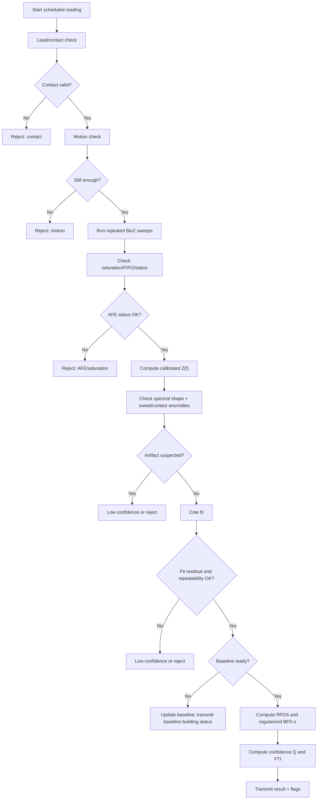

---

### 4.4.1. Contact Quality

Inputs:

- MAX30009 lead/contact status,
- low-current lead-on detection,
- impedance magnitude outliers,
- repeated sweep variance,
- electrode DC bias status if available.

Reject if:

- leads are off,
- impedance is outside expected physiological/electrode range,
- repeated sweeps differ excessively,
- saturation/clipping occurs.

“Expected physiological/electrode range” is `[UNVERIFIED — no project range has been established]`; it may be logged but shall not be a hard human-data gate until Stage 2 freezes a range independent of Stage 3 outcomes. <!-- REVIEW 2026-08-26: Prevented an undefined range from silently rejecting data. -->

---

### 4.4.2. Sweat Artifact Detection

The mechanisms below are supported by skin-interface literature, but their use as a detector is `[UNVERIFIED — sensitivity and specificity are unknown for this device]` ([Iftime et al., 2025](https://doi.org/10.3390/bioengineering12090926)). Until the moisture challenge validates a hard rule, “sweat suspected” lowers confidence or requests a dry-and-repeat measurement rather than claiming the cause is known. <!-- REVIEW 2026-08-26: Distinguished known sweat physics from an unvalidated artifact classifier. -->

Sweat artifact shall be suspected when:

- contact impedance suddenly drops,
- low-frequency impedance collapses disproportionately,
- spectrum shape deviates from expected Cole-like response,
- phase behavior becomes unstable,
- adjacent electrodes may be bridged by surface moisture,
- rapid shift occurs without plausible physiological time course.

Mitigations:

1. Hydrophobic isolation rings around electrodes.
2. Absorbent sweat barriers between electrodes.
3. Adequate electrode spacing where mechanically possible.
4. Stillness-gated repeated sweeps.
5. Sweat/artifact flag in BLE record.
6. User instruction: “wipe/dry sensor and recheck.”

---

### 4.4.3. Motion Artifact Detection

Use the ADXL362 three-axis accelerometer plus repeated-sweep BioZ instability. The accelerometer shall be sampled over a fixed window that covers the pre-sweep stillness check and active BioZ acquisition; record its range, output-data rate, filter/mode, window length, and time alignment with each sweep.

Motion metric:

$$
a_{rms}=\sqrt{\frac{1}{N}\sum_{n=1}^{N}\left\lVert\mathbf{a}_n-\bar{\mathbf{a}}\right\rVert_2^2}
$$

where $\mathbf{a}_n=[a_{x,n},a_{y,n},a_{z,n}]^T$ after the frozen calibration/filter, and $\bar{\mathbf{a}}$ is the vector mean over the same window. Use one documented acceleration unit throughout. Because the ADXL362 has no gyroscope, this metric can miss slow orientation changes, static muscle contraction, and constant-velocity movement. The threshold and sampling profile are `[UNVERIFIED — pending bench motion trials and Stage 2 challenge data]`. If the accelerometer is missing, stale, or faulted, preserve a sensor-fault flag; BioZ instability may still reject the reading, but firmware shall not label motion as the cause. <!-- REVIEW 2026-08-26: Replaced the optional/underspecified IMU path with the selected three-axis accelerometer and an executable vector metric. -->

Because $a_{rms}$ differences samples against their own window mean, a fixed 0 g offset cancels, but the ADXL362's guaranteed ±10% sensitivity calibration error (§4.1.6) does not; if per-part calibration is not performed, $a_{threshold}$ shall carry at least a 10% margin above the intended detection floor. The sensor's own noise density (550 µg/√Hz on X/Y, 920 µg/√Hz on Z in normal operating mode, §4.1.6) also contributes to $a_{rms}$ at rest and shall be characterized on stationary bench data before the threshold is frozen, so that sensor self-noise is not mistaken for a motion margin. <!-- REVIEW 2026-08-30: Added the datasheet-sourced calibration-error and noise-floor discussion the a_rms threshold derivation did not previously account for. -->

Reject if:

$$
a_{rms}>a_{threshold}
$$

Also reject if repeated sweep coefficient of variation is high:

$$
CV_{R0}=\frac{\sigma_{R0}}{\mu_{R0}}\times100\%
$$

**Provisional project thresholds:**

| Metric               | Action                        |
| -------------------- | ----------------------------- |
| $CV_{R0}<3\%$        | Accept.                       |
| $3\%\le CV_{R0}<5\%$ | Accept with lower confidence. |
| $CV_{R0}\ge5\%$      | Reject for MVP.               |

---

### 4.4.4. Temperature Gate

Record the single MCP9808 fixture-proximal channel with a frozen address and physical placement:

$$
T_{fixture,current}
$$

Store its baseline value:

$$
T_{fixture,baseline}
$$

Use it for the provisional quality gate:

$$
\Delta T_{fixture}=T_{fixture,current}-T_{fixture,baseline}
$$

Room temperature is recorded manually with each session (§4.9.1) as context only; it is not a device channel and is not used by the firmware gate.

**Provisional project rule:**

| Absolute fixture-temperature change | Action |
| ----------------------------------- | ------ |
| $\lvert\Delta T_{fixture}\rvert<1\ ^\circ\text{C}$ | No penalty. |
| $1\le\lvert\Delta T_{fixture}\rvert<2\ ^\circ\text{C}$ | Small confidence penalty. |
| $2\le\lvert\Delta T_{fixture}\rvert\le4\ ^\circ\text{C}$ | Medium penalty / flag. |
| $\lvert\Delta T_{fixture}\rvert>4\ ^\circ\text{C}$ | Reject or show low confidence. |

These bands have no external validation for the MCP9808 breakout or this fixture and shall be frozen from Stage 2 data before Stage 3. If Stage 2 shows that one fixture channel cannot separate local skin/fixture heating from room-temperature change, add a second MCP9808 as an ambient reference under a dated amendment. A missing, stale, or thermally invalid channel shall set an explicit flag and cannot be silently replaced by the nRF52840 die temperature. No temperature correction shall be applied without trained and held-out validation data. <!-- REVIEW 2026-08-26: Defined separate fixture and ambient channels and prevented the local breakout reading from being mislabeled as validated skin temperature. --> <!-- REVIEW 2026-11-14: Reduced the gate to the single fixture channel; ambient is manual session context, and a second sensor requires an amendment. -->

The MCP9808's own guaranteed accuracy (±0.25°C typical, ±0.5°C maximum from −20°C to +100°C; §4.1.6) means the current $1\,^\circ\text{C}$ no-penalty band above is only 2–4× the sensor's rated error. Stage 2 shall confirm that the bands are tracking real fixture-temperature change and not primarily sensor error; the ±0.5°C figure, not zero, is the correct noise floor to compare candidate bands against. <!-- REVIEW 2026-08-30: Added the datasheet accuracy figure and flagged its proximity to the provisional 1°C gate band. -->

---

### 4.4.5. Confidence Score

**Heuristic design, not a probability:** compute confidence:

$$
Q=100-P_{contact}-P_{motion}-P_{sweat}-P_{temp}-P_{repeat}-P_{fit}-P_{saturation}
$$

The additive form assumes penalties can be combined linearly even though artifacts may be correlated; that assumption is `[UNVERIFIED — pending replay and challenge tests]`. Hard failures are evaluated before Q. <!-- REVIEW 2026-08-26: Exposed the confidence model's independence/linearity assumption. -->

**Provisional penalties:**

| Condition                 | Penalty |
| ------------------------- | ------: |
| Minor contact instability |      15 |
| Major contact instability |  Reject |
| Motion detected           |      40 |
| Sweat suspected           |      30 |
| Temperature shift 2–4 °C  |      20 |
| Repeatability CV 3–5%     |      20 |
| Cole fit residual >5%     |      30 |
| Saturation/clipping       |  Reject |
| Lead-off                  |  Reject |

Confidence bands:

|     Q | Display                     |
| ----: | --------------------------- |
|   ≥85 | High                        |
| 65–84 | Medium                      |
| 40–64 | Low                         |
|   <40 | Do not display a BioZ fluid-trend category |

Q describes rule-based measurement quality only. It is not a calibrated probability that the reading or physiological interpretation is correct. <!-- REVIEW 2026-08-26: Prevented probabilistic interpretation of the heuristic score. -->

---

## 4.5. Firmware State Machine

The firmware has two layers. The device state machine (§4.5.1) owns power, button, LED, BLE, and battery behavior. The measurement pipeline (§4.5.2) is a linear sequence of steps that runs inside the device machine's `MEASURING`, `PROCESSING`, and `RESULT_READY` states. `docs/state_machine.puml` is the diagram source for §4.5.1 and shall match this section. <!-- REVIEW 2026-11-14: Replaced the measurement-only FSM with the device state machine from docs/state_machine.puml and nested the §4.4 pipeline inside it. Rejected readings are retained, measurement mode is fixed at build time, and sleep uses System ON idle. -->

### 4.5.1. Device State Machine

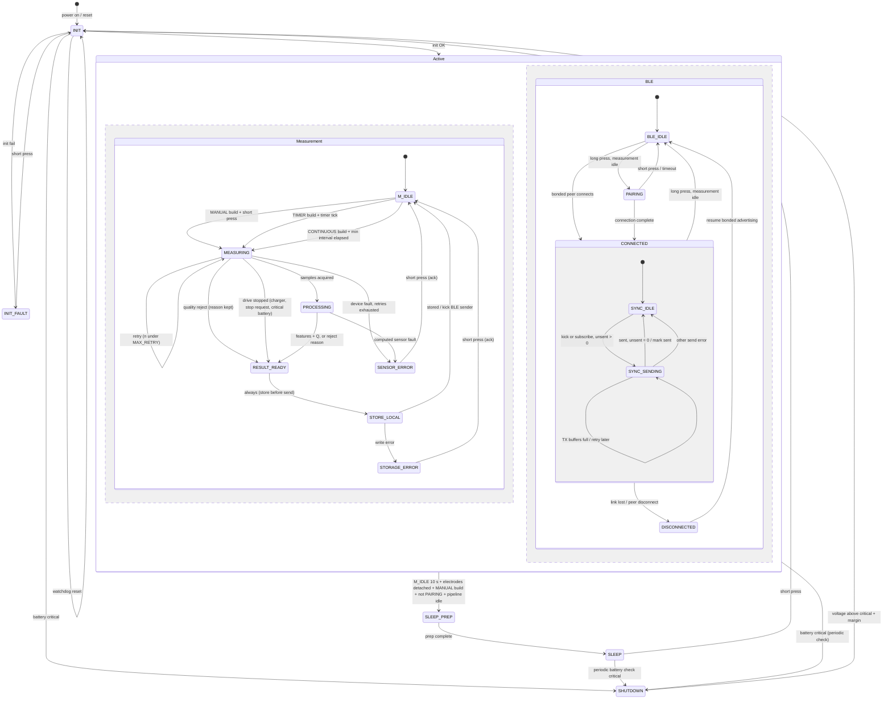

The two regions inside `Active` run in parallel. "Measurement idle" means the Measurement region is not in `MEASURING` or `PROCESSING`. The `M_IDLE` sleep condition counts from the end of the 10 s result display (§4.5.3).

The battery has no state region. A periodic check reads it in every device state, with hysteresis, and classifies it as OK, LOW, or CRITICAL. LOW shows the yellow beat. CRITICAL moves `INIT`, `Active`, or `SLEEP` to `SHUTDOWN`, and blocks the start of a measurement. <!-- REVIEW 2026-11-14: Removed the TRANSMIT state and the Battery Monitor region, added the CONNECTED sync substates, the drive-stop path and INIT -> SHUTDOWN, to match firmware/src/fsm and docs/state_machine.puml. -->

| Rule | Requirement |
| ---- | ----------- |
| Rejected readings | Every reject, whether a quality reject or a device fault, produces a stored record with its reason (§4.9.1). `RESULT_READY` never discards a reading. A reject shows no result color on the LED. |
| Device faults | AFE not responding, SPI/FIFO error after retries, sensor detached, and step timeout are device faults. The pipeline stops the AFE drive before it assembles the reject. On entry, `SENSOR_ERROR` stores the reject record with the fault reason, then waits for a short-press acknowledgement. If that write fails, the device logs the error and keeps the red fault LED until the acknowledgement, and the record is lost. <!-- REVIEW 2026-11-25: Defined the store-failure path. The team must confirm it. --> Quality rejects (contact, motion, temperature, spectral, fit, low Q) return to `M_IDLE` through `RESULT_READY` and `STORE_LOCAL`. |
| Continuous mode | Every cycle runs the full pipeline, including the motion gate (§2.1.3). A build-time minimum interval separates measurements. Continuous and TIMER builds never enter `SLEEP`, because only a button press wakes `SLEEP` and the measurement timer stops there. <!-- REVIEW 2026-11-25: A TIMER build with an interval above 10 s slept before its first measurement. The team must confirm this choice. --> |
| Local copy | Every record is stored locally before it is sent. The store is bounded: when full it overwrites the oldest record and increments a lost-record counter (§3.2). Once the peer subscribes on an encrypted link, unsent records go out oldest first, one at a time. A record is marked sent only when its last fragment has left the radio; if the link drops first, it is sent again after reconnection and the consumer drops the duplicate by session and sequence. A full TX buffer is retried while the link is up and never blocks the state machine. |
| BLE advertising | `BLE_IDLE` advertises only to bonded peers (filter accept list), or not at all if no bond exists. `PAIRING` opens connectable advertising with bonding and a build-time timeout. The consumer is a phone or test logger (R.9); watch support is stretch (R.14). |
| Charging lockout | `SAFETY_CHECK` rejects every measurement while VBUS/charger power is present (§4.10.2). A bench build may enable a USB override only for disconnected-electronics or phantom work (§4.1.5); it sets a flag in every record and is prohibited for body-connected measurement. The pipeline also checks VBUS, the critical battery level, and any stop request immediately before every drive step and on every AFE status poll (about every 2 ms during the sweep), and stops the drive when any of them fails. That reading is stored as a reject: CHARGING for VBUS, UNSAFE for a stop request or critical battery. |
| AFE ownership | Only the pipeline thread drives the MAX30009. `INIT` is the one exception: it stops the AFE first, because an MCU or watchdog reset does not reset the MAX30009, and it runs only while the pipeline is idle. `SHUTDOWN` and `SLEEP_PREP` ask the pipeline to stop and wait for it to go idle; if it does not within one step budget plus margin, the device cold-reboots. |
| Electrode detachment | Read from the MAX30009 lead-off status (§4.4.1). Until the AFE is integrated, it comes from the simulation backend (§4.3.14). |
| Sleep and shutdown power state | `SLEEP` and `SHUTDOWN` use System ON idle during the current debug phase. nRF52840 System OFF cannot wake from the RTC, so it cannot run the periodic battery check or the sleep LED beat ([Nordic DevZone](https://devzone.nordicsemi.com/f/nordic-q-a/19276/deep-sleep-with-rtc-wakeup/74705)). Revisit with LPCOMP or an external wake source when the wearable power budget (§4.11) is measured. |

### 4.5.2. Measurement Pipeline

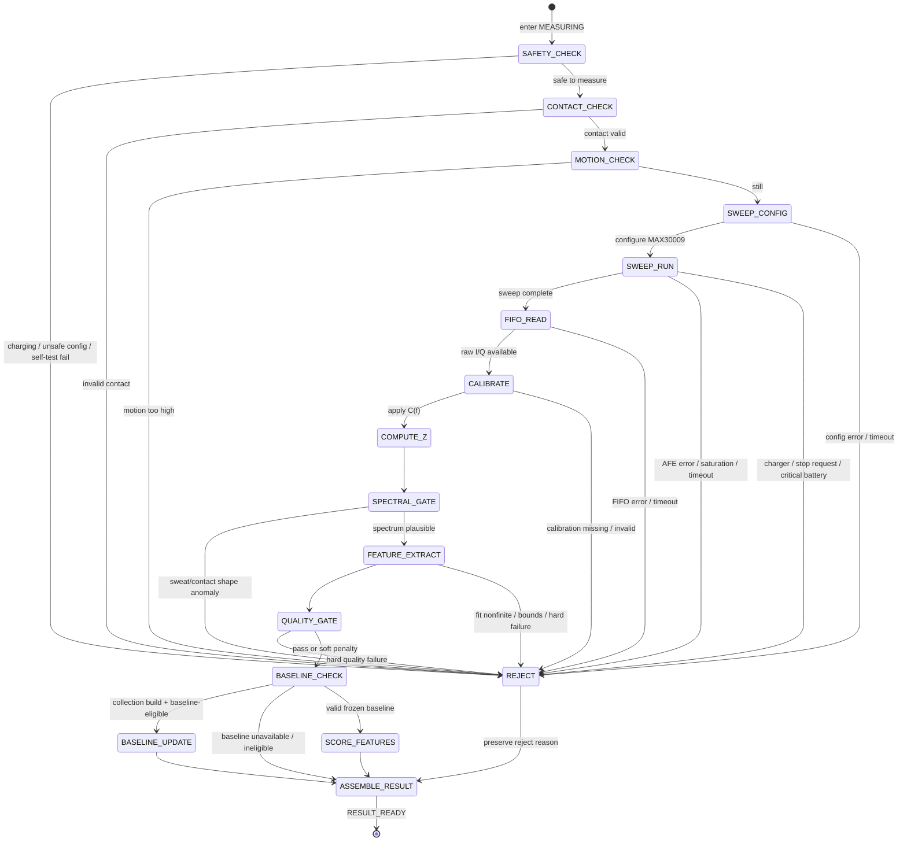

| Device state (§4.5.1) | Pipeline steps |
| --------------------- | -------------- |
| `MEASURING` | `SAFETY_CHECK` through `FIFO_READ` |
| `PROCESSING` | `CALIBRATE` through `BASELINE_UPDATE` or `SCORE_FEATURES` |
| `RESULT_READY` | `ASSEMBLE_RESULT`; `STORE_LOCAL` then follows in the device machine, and the BLE region sends the stored record |

**Design decision:** the pipeline is implemented as a linear step table with a bounded timeout on every step, not as a second nested state machine. An AFE step timeout stops the drive before the reject is assembled. A stop request ends the run at the next step, so the pipeline is idle within one step.

`FEATURE_EXTRACT` produces only baseline-independent outputs: $R_0$, $R_\infty$, $R_{50}$, $X_{50}$, $\theta_{50}$, and fit residual. RFDS and BFD-z cannot be computed until `BASELINE_CHECK` confirms a valid personal baseline.

**Ownership decision:** `SCORE_FEATURES` is a baseline-dependent `bioz_feature_extractor` operation that computes RFDS/BFD-z. `ASSEMBLE_RESULT` is owned by `ble_hydration_service` and combines features, Q, flags, baseline state, reject reason, and any permitted FTI category. `REJECT` always reaches `ASSEMBLE_RESULT`, so rejected measurements are retained instead of disappearing. `BASELINE_UPDATE` runs only in a baseline-collection build (§4.5.5) and only for predeclared baseline-eligible readings; Stage 3 and later frozen evaluations use builds with it disabled.

`SPECTRAL_GATE` is the early subset of `quality_gate_service` that can operate directly on calibrated $Z(f)$. The later `QUALITY_GATE` uses fit residual, repeatability, and temperature context. This ordering matches §4.4.

### 4.5.3. LED Indication

The device indicator is an external binary RGB LED wired as defined in the board devicetree overlay. Each channel is only on or off, giving seven colors plus off. Patterns are timer-driven; there is no dimming.

| Color | Meaning |
| ----- | ------- |
| Red | Low BioZ fluid trend / fault / critical battery |
| Yellow | Slightly low BioZ fluid trend / warning |
| Green | Baseline BioZ fluid trend |
| Cyan | Above-baseline BioZ fluid trend |
| Blue | Bluetooth |
| Magenta | Measurement in progress |
| White | Device power state (boot, sleep) |

| Pattern | Definition |
| ------- | ---------- |
| STEADY | On |
| SLOW | 1 Hz (500 ms on / 500 ms off) |
| FAST | 4 Hz (125 ms on / 125 ms off) |
| TRIPLE | Three 100 ms flashes, then off |
| BEAT | One 100 ms flash, repeated at a stated interval |

Priority, highest first; a higher request preempts a lower one, and the lower one resumes when the higher one clears:

1. Faults: `INIT_FAULT`, `SENSOR_ERROR`, `SHUTDOWN`
2. `STORAGE_ERROR`
3. BLE: `PAIRING`, `CONNECTED`
4. Measurement activity: `MEASURING`, `PROCESSING`
5. Result display
6. Battery LOW beat, shown only when the LED is otherwise idle

The `SLEEP` beat exists only in `SLEEP`, so it never competes.

| State | LED |
| ----- | --- |
| `INIT` | White STEADY |
| `INIT_FAULT` | Red FAST |
| `SENSOR_ERROR` | Red SLOW |
| `STORAGE_ERROR` | Yellow SLOW |
| `SHUTDOWN` | Off; red FAST for 2 s on button press |
| `PAIRING` | Blue SLOW |
| `CONNECTED` | Blue TRIPLE on entry, then none |
| `MEASURING` | Magenta SLOW |
| `PROCESSING` | Magenta FAST |
| `RESULT_READY`, `STORE_LOCAL`, then `M_IDLE` | Result display for 10 s after the result, then off |
| Battery LOW | Yellow BEAT every 5 s |
| `SLEEP` | White BEAT every ~4 s |
| `SLEEP_PREP`, `BLE_IDLE`, `DISCONNECTED`, battery OK | None |

Result colors are shown only in builds with the FTI LED option enabled (§4.5.5). The option defaults to off because the user-facing category stays disabled until its validation gate passes (§4.8.2).

| FTI category (§4.3.12) | Result display |
| ---------------------- | -------------- |
| Very low, Low | Red STEADY |
| Slightly low | Yellow STEADY |
| Baseline | Green STEADY |
| Above baseline | Cyan STEADY |
| Uncertain ($Q<40$), rejected, baseline-building, research-only | No result color |

The LED cannot show confidence, so R.12 is satisfied by the BLE record and the logger display, not by the LED. Red and yellow each carry several meanings and are told apart by pattern alone; this is an accepted debug-phase limitation.

### 4.5.4. Button Input

The device has one button. Presses are debounced (50 ms provisional), and a long press is a press held at least a build-time threshold (2 s provisional).

| Context | Short press | Long press |
| ------- | ----------- | ---------- |
| BLE in `PAIRING` | Cancel pairing; takes precedence over every row below | Ignored |
| `INIT_FAULT` | Retry `INIT` | Ignored |
| `M_IDLE`, MANUAL build | Start a measurement, unless the battery is critical | `BLE_IDLE` → `PAIRING`, or `CONNECTED` → disconnect and return to bonded advertising |
| `M_IDLE`, TIMER or CONTINUOUS build | Ignored | As above |
| `SENSOR_ERROR`, `STORAGE_ERROR` | Acknowledge and return to `M_IDLE` | As above |
| `MEASURING`, `PROCESSING` | Ignored | Ignored |
| `SLEEP` | Wake to `INIT` | Ignored |
| `SHUTDOWN` | Red FAST for 2 s | Ignored |

### 4.5.5. Build-Time Configuration

Measurement mode and the other options below are fixed at build time in `prj.conf`. A build cannot switch them at run time.

| Option | Values | Default | Effect |
| ------ | ------ | ------- | ------ |
| Measurement mode | MANUAL / TIMER / CONTINUOUS | MANUAL | Selects the `M_IDLE` → `MEASURING` trigger |
| Timer period / continuous minimum interval | Seconds | TBD | Spacing between measurements |
| Baseline collection | On / off | Off | Enables `BASELINE_UPDATE`; off in Stage 3 and every frozen evaluation build |
| FTI LED | On / off | Off | Enables result colors (§4.5.3) |
| AFE simulation | On / off | On until AFE integration | Selects the simulation backend (§4.3.14) |
| Scoring oracle | On / off | Off | Substitutes scenario truth for scoring outputs (§4.3.14) |
| Bench USB override | On / off | Off | Bypasses only the charging check (§4.5.1) |

Every record carries the measurement mode and the state of each on/off option above as flag bits, next to `firmware_version`, so records from different builds are never silently pooled (Risk 17). Fixing baseline collection at build time also makes the Stage 3 freeze auditable: the frozen build's hash shows that baseline updates were compiled out.

### 4.5.6. Structural Review

Manual review of §4.5.1–§4.5.2 on 2026-11-14 found:

| Structural check | Result |
| ---------------- | ------ |
| All documented states reachable from `INIT` | Pass by inspection; executable FSM test pending |
| Every `Active` state has a bounded path back to `M_IDLE` | Pass in diagram; retry bounds and step timeouts implemented in firmware, not executed |
| Every pipeline and device-fault failure stores a reject record | Pass in diagram |
| Baseline-dependent scoring occurs only after baseline validation | Pass in diagram |
| Execution on the simulation backend (§4.3.14) | **UNVERIFIED — NOT EXECUTED** |
| Hardware execution on nRF52840/MAX30009 | **UNVERIFIED — NOT EXECUTED** |

The firmware state machine under `firmware/src/fsm/` was reconciled with §4.5.1–§4.5.5 and `docs/state_machine.puml` on 2026-11-14. The firmware builds for nRF52840 and the twister suites build, but no suite covers the state machine and none were executed on this date. `[UNVERIFIED — reconciled by inspection and build only]`

On 2026-11-25 the firmware stopped discarding rejects. `RESULT_READY` now always goes to `STORE_LOCAL`, `SENSOR_ERROR` stores its reject on entry, and BLE packet v3 carries the reject reason. On the nRF52840 DK, a charging reject (`hs vbus 1`) was stored with reason 1. The `SENSOR_ERROR` store did not run, because the AFE stub cannot fail. `[UNVERIFIED - SENSOR_ERROR store path built but not executed]`

---

## 4.6. MAX30009 Driver Design for nRF52840

### 4.6.1. Driver Scope

The firmware shall implement a minimal nRF52840 SPI integration for MAX30009. The [ADI no-OS driver](https://analogdevicesinc.github.io/no-OS/drivers/afe/max30009.html) is a reference for register/configuration semantics, while the separate [MAX32655-to-MAX30009 repository](https://github.com/analogdevicesinc/MAX32655_MAX30009) is a reference for SPI framing and tagged FIFO parsing. Neither is a drop-in nRF Connect SDK/Zephyr driver, and neither project's register profile shall be copied without a field-by-field datasheet review. <!-- REVIEW 2026-08-26: Distinguished the I²C-oriented reusable logic from the separate SPI example and bounded both references. -->

The driver shall support:

1. reset,
2. register read/write,
3. bitfield update,
4. BioZ configuration,
5. frequency configuration,
6. current-drive configuration,
7. FIFO read,
8. status read,
9. lead/contact check,
10. sweep start/stop.

---

### 4.6.2. Driver API

```c
int max30009_init(const struct max30009_config *cfg);
int max30009_reset(void);
int max30009_read_reg(uint8_t addr, uint8_t *value);
int max30009_write_reg(uint8_t addr, uint8_t value);
int max30009_update_bits(uint8_t addr, uint8_t mask, uint8_t value);

int max30009_config_bioz(const struct bioz_config *cfg);
int max30009_set_frequency(uint32_t requested_hz, uint32_t *actual_hz);
int max30009_set_current(uint32_t requested_nA_rms, uint32_t *actual_nA_rms);
int max30009_start_sweep(void);
int max30009_stop(void);

int max30009_read_fifo(struct bioz_iq_sample *samples, size_t max_samples, size_t *count);
int max30009_read_status(struct max30009_status *status);
int max30009_check_contact(struct contact_status *status);
```

The frequency/current API shall expose the value actually represented by the selected register fields and shall fail on an unsupported or unsafe request; silent rounding is forbidden. Peak, peak-to-peak, and RMS current units must be converted explicitly from the datasheet definition. `max30009_start_sweep()` is a project-level sequence over discrete configurations, not an assumed single-chip “sweep” command. <!-- REVIEW 2026-08-26: Corrected the API's implication of arbitrary exact settings and clarified unit and sweep semantics. -->

---

### 4.6.3. SPI Transport and FIFO Contract

**Provisional bring-up profile:** start at 1 MHz, 8 bits per word, most-significant bit first, using the clock polarity/phase corresponding to the datasheet timing diagram. The ADI external-MCU example configures a 1 MHz bus and its SDK's mode value `0`, but its source warns that mode numbering differs by SDK. The nRF configuration shall therefore be confirmed from actual clock/data edges with a logic analyzer rather than by copying the integer mode value. <!-- REVIEW 2026-08-26: Converted the public SPI example into a falsifiable initial profile instead of an assumed final configuration. -->

`CSB/I2C_SEL` shall be held low during power-up/interface selection to select SPI. During the reviewed initialization, firmware shall set `DISABLE_I2C=1`; it shall then use `CSB` as a normal active-low chip select, high while idle and low for each complete transaction ([MAX30009 datasheet](https://www.analog.com/media/en/technical-documentation/data-sheets/MAX30009.pdf)).

The public SPI example uses the following three-byte register transactions:

| Operation | Byte 0 | Byte 1 | Byte 2 | Receive behavior |
| --------- | ------ | ------ | ------ | ---------------- |
| Register write | Register address | `0x00` | Register value | Ignore received bytes. |
| Register read | Register address | `0x80` | `0x00` dummy | Register value is received during byte 2. |

Chip select shall remain asserted across the entire transaction. Firmware shall submit each command as one SPIM transfer or otherwise prove by logic-analyzer capture that `CSB` does not toggle between bytes. FIFO access shall similarly use one framed burst: issue the FIFO read header and provide continuous dummy clocks for the required response bytes. Exact burst alignment and the maximum safe SPI rate remain `[UNVERIFIED — confirm against the Rev. 2 datasheet and received hardware before Gate 2]`.

Each FIFO word is three bytes containing a tag and signed 20-bit sample in the format used by the ADI example:

$$
tag=(b_0>>4)\mathbin{\&}0x0F
$$

$$
u_{20}=((b_0\mathbin{\&}0x0F)<<16)\;|\;(b_1<<8)\;|\;b_2
$$

$$
s_{20}=\begin{cases}
u_{20}-2^{20}, & u_{20}\mathbin{\&}2^{19}\ne0\\
u_{20}, & \text{otherwise}
\end{cases}
$$

Firmware shall validate the tag-to-I/Q mapping, sample order, count, sign extension, and phase polarity on resistor and RC phantoms. Unknown tags, incomplete words, impossible counts, FIFO overflow, saturation, or frequency/phase unlock status shall stop the active drive and reject the reading rather than be skipped silently.

The nRF52840 orchestrates the multifrequency sweep:

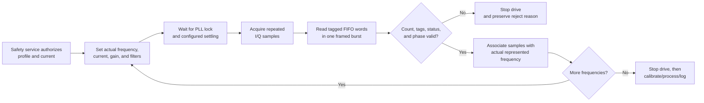

Every wait and SPIM operation shall have a bounded timeout. The safety service, not the generic SPI transport, authorizes the current/frequency profile. <!-- REVIEW 2026-08-26: Added the byte-level transport contract, tagged-word decoding, MCU-controlled sweep sequence, and fail-safe behavior. -->

---

### 4.6.4. Driver Bring-Up Order

1. Run the stock EVKIT on a known resistor and RC phantom; save GUI settings, raw data, and the complete register manifest.
2. Power down, install the verified interposer/translator path from §4.1.5, and prove the supplied controller cannot drive the bus.
3. Check all rails, common ground, the reviewed `CSB/I2C_SEL` low startup state, and no-backfeed behavior before enabling SPIM.
4. Select SPI, set `DISABLE_I2C=1` in the reviewed initialization sequence, configure the nRF bus at the provisional 1 MHz profile, and confirm one 24-clock transaction with a logic analyzer.
5. Read part-ID/status registers identified in the datasheet; reject all-zero, all-one, or inconsistent responses.
6. Read, modify, read back, and restore one reviewed configuration register.
7. Execute the reviewed reset sequence, configure the clock/PLL, and require lock status within a timeout.
8. Configure the BioZ transmit/receive path at the lowest reviewed current and one known frequency.
9. Generate a reading into a resistor phantom, poll status, and read the FIFO without interrupts.
10. Decode tags and signed I/Q; verify magnitude and near-resistive phase against the stock EVKIT result.
11. Test an RC phantom to confirm Q sign, phase direction, sample/frequency association, and complex calibration.
12. Expand to the 9-point sweep, then the 24-point validation sweep, recording actual represented frequencies.
13. Compare stock-EVKIT and nRF-controlled results against the Stage 1 gates using the same phantoms and register profile.
14. Add the `INT` path only after polling passes; then inject FIFO, saturation, unlock, timeout, and lead/contact faults.
15. Permit body-connected work only after the complete translated path, charging lockout, current verification, and institutional gates pass.

---

### 4.6.5. Driver Risks

| Risk                                           | Mitigation                                                                |
| ---------------------------------------------- | ------------------------------------------------------------------------- |
| Register settings copied blindly from examples | Build register config table with comments and datasheet references.       |
| FIFO format misunderstood                      | Validate with known resistor and expected phase.                          |
| SPI mode integer copied across SDKs             | Derive CPOL/CPHA from the datasheet timing diagram and verify clock/data edges with a logic analyzer. |
| 3 V/3.3 V GPIO drives a 1.8 V sensor input      | Measure both rails and use verified dual-supply, fixed-direction translation where required. |
| Supplied MCU and nRF52840 drive the bus together | Use a reversible interposer/disconnect and prove single-master isolation before power-up. |
| Sensor board is back-powered through SPI or flex rails | Select one source per rail; test powered-off pin current and rail voltage before connection. |
| FFC orientation or board revision is assumed   | Record revisions and continuity-check every net against the matching schematic. |
| EVKIT board difficult to control externally    | Start with EVKIT GUI logs; use a reversible interposer and preserve an EVKIT-export fallback. |
| Public examples target I²C or a different SPI/GSR setup | Reuse only reviewed register/framing portions; do not copy ambiguous jumpers, capacitor changes, or application settings. |
| Zephyr abstraction consumes time               | Decide SDK in Sprint 1; use the smallest local module consistent with that SDK. |

<!-- REVIEW 2026-08-26: Added voltage-domain, bus-contention, back-power, connector-revision, and cross-example integration risks. -->

---

## 4.7. BLE Data Record

BLE records shall be validation-friendly and serialized field by field; transmitting a compiler-native C struct is forbidden because padding, byte order, and enum size are not a stable wire format. <!-- REVIEW 2026-08-26: Added an explicit serialization requirement. -->

| Field              | Type   | Resolution | Notes                                         |
| ------------------ | ------ | ---------: | --------------------------------------------- |
| version            | uint8  |          — | Packet version.                               |
| firmware_version   | uint16 |          — | Build/version table index.                    |
| calibration_version | uint16 |         — | Calibration manifest index.                   |
| register_profile   | uint16 |          — | MAX30009 profile index.                       |
| session_id         | uint16 |          — | Joins fragments/raw logs within one session.  |
| timestamp_s        | uint32 |        1 s | Local or Unix time.                           |
| sequence           | uint16 |          1 | Detect dropped records.                       |
| flags              | uint32 |    bitmask | Contact/motion/sweat/temp/fit/saturation, sensor fault/staleness, and build identity (§4.5.5). |
| confidence         | uint8  |      0–100 | Required.                                     |
| status             | uint8  |       enum | Rejected/baseline-building/baseline/above/slightly low/low/very low/uncertain. |
| RFDS_centi_pct     | int16  |      0.01% | ΔR₀%.                                         |
| BFD_z_centi        | int16  |     0.01 z | Signed deviation.                             |
| R0_deci_ohm        | uint16 |      0.1 Ω | Current R₀.                                   |
| Rinf_deci_ohm      | uint16 |      0.1 Ω | Current R∞.                                   |
| theta50_centi_deg  | int16  |      0.01° | Phase near 50 kHz.                            |
| fit_error_bp       | uint16 |      0.01% | Fit residual.                                 |
| fixture_temp_centi_c | int16 |    0.01 °C | MCP9808 fixture channel; `INT16_MIN` when stale/faulted. |
| optional_raw_index | uint16 |          — | Link to raw log if stored.                    |
| record_crc16       | uint16 |          — | Application-record integrity after reassembly. |

The listed packed fields total at least 39 bytes before any fragmentation header. Bluetooth LE's default ATT MTU is 23 bytes, and a notification cannot exceed the negotiated ATT payload; therefore this record cannot assume one default-size notification ([Nordic Developer Academy, data exchange exercise](https://academy.nordicsemi.com/courses/bluetooth-low-energy-fundamentals/lessons/lesson-4-bluetooth-le-data-exchange/topic/blefund-lesson-4-exercise-3/); [Bluetooth SIG ATT specification](https://www.bluetooth.com/wp-content/uploads/Files/Specification/HTML/Core-54/out/en/host/attribute-protocol--att-.html)). The protocol shall either negotiate a sufficient MTU or fragment by `session_id + sequence + fragment_index + fragment_count`, with a tested fallback that does not depend on successful MTU negotiation. Specify byte order, signed encoding, status/flag values, timestamp epoch/source, saturation behavior, and CRC polynomial in the packet specification. <!-- REVIEW 2026-08-26: Added both ordered temperature channels and updated the minimum packed-record size. -->

Raw logging is **required in Stages 1–3** and optional only for later product-direction builds:

- frequency list,
- R array,
- X array,
- repeated sweep count,
- per-frequency status.

If local raw storage is unavailable or full, the record shall carry an explicit raw-data-missing flag; it must not leave a stale `optional_raw_index`. <!-- REVIEW 2026-08-26: Reconciled “optional” raw data with R.8 and added storage-failure behavior. -->

---

## 4.8. User Display

### 4.8.1. Recommended Display

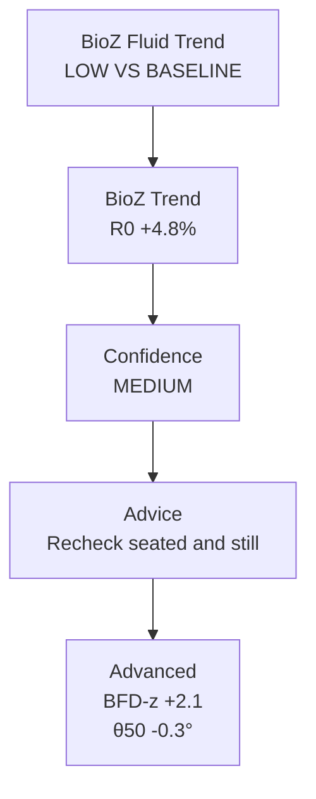

---

### 4.8.2. User Language

Use:

> **BioZ Fluid Trend: Low vs baseline**  
> Your fitted arm BioZ $R_0$ is **4.8% above baseline**. This direction can be associated with reduced tissue conductivity, but sweat, temperature, blood flow, motion, placement, or strap contact may also contribute. Measurement quality: **Medium**. Recheck seated and still.

The 4.8% and “Medium” values are illustrative only. This user-facing category is disabled until its intended-use validation gate passes; before then, the research display shows calibrated BioZ change and rule-based quality only. <!-- REVIEW 2026-08-26: Made the example non-empirical, corrected resistance to fitted R0, and reduced causal/medical overstatement. -->

Do not use:

> “You are dehydrated.”

Do not use:

> “You are 72% hydrated.”

---

## 4.9. Validation Plan

Validation is the project. Each stage answers one different question; passing a later stage never repairs a failed earlier stage.

The arm-worn precedent enrolled nine participants, analyzed dehydration data from eight after one data-quality exclusion, and evaluated 24-hour free-living behavior in one participant; it supports feasibility, not population accuracy, and it used diuretic-induced rather than exercise/sweat-induced water loss ([Jankovic et al., 2025](https://pmc.ncbi.nlm.nih.gov/articles/PMC12304993/)). <!-- REVIEW 2026-08-26: Added the closest precedent's actual evidence boundary so this plan does not inherit broader claims from its title. -->

### 4.9.1. Claim Ladder and Required Records

| Stage | Question answered | Required achievement | Strongest allowed claim after passing |
| ----- | ----------------- | -------------------- | ------------------------------------- |
| 0 — Lock | Is the protocol safe, reviewable, and reproducible? | Approved protocol, frozen configurations, traceable data schema. | “The test plan is ready.” No measurement claim. |
| 1 — Phantom | Does the electronics chain measure known impedances accurately and safely? | Magnitude, phase, repeatability, current, status, and calibration gates pass. | “The system measures calibrated complex impedance on known loads.” |
| 2 — Repeatability | Can the same arm measurement be reproduced after reapplication and across days? | One geometry passes within-session, reattachment, and day-to-day gates. | “The system repeatably measures upper-arm BioZ under controlled placement.” |
| 3 — Controlled pilot | Does the personal BioZ trend move with acute exercise net body-mass loss and later move toward baseline after rehydration? | Within-subject signal exceeds repeatability noise; quality gates work. | “Pilot data show an exploratory within-subject BioZ trend associated with net body-mass change in the studied sessions.” |
| 4 — Free-living | Does the system remain usable and conservative outside the lab? | Valid-yield, rejection, battery, packet, and alert-recheck results documented. | “The prototype reports a quality-gated personal BioZ trend in limited free-living use.” |
| 5 — Independent validation | Does a frozen model predict a reference outcome on unseen participants/sessions? | Predeclared thresholds and model pass held-out accuracy and calibration analysis. | A bounded estimate of acute exercise-related body-mass fluid loss, with uncertainty. Still not a clinical hydration diagnosis. |

Unless a value is already a requirement elsewhere in this document, numerical sample counts, timings, correlations, and acceptance limits introduced in §4.9 are **provisional protocol targets**. The proposed 3–5-person studies are convenience-sized feasibility work and are not supported by a prospective power calculation. Stage 0 reviewers shall approve or revise and freeze the protocol before affected data collection. Later changes require a dated amendment and cannot be selected after viewing outcome results. <!-- REVIEW 2026-08-26: Explicitly labeled the sample-size and gate assumptions and prohibited outcome-driven changes. -->

Primary gates to freeze are:

| Gate | Primary decision variable | Provisional rule before Stage 0 approval |
| ---- | ------------------------- | ---------------------------------------- |
| Stage 1 | Per-frequency known-load error, repeatability, current, and fault response | Use §4.9.3 limits; any unsafe-current result is a hard stop. |
| Stage 2 | Within-application, reattachment, day-to-day error, and artifact challenge | Use §4.9.4 limits; no baseline if day-to-day limit fails. |
| Stage 3 | Within-person direction and signal relative to that person's Stage 2 noise | No fixed $r$ pass threshold; report slope, $r$, uncertainty, $n$, and control drift. |
| Stage 4 | Reliability/quality behavior | Stretch stage; no fluid-accuracy claim. |
| Stage 5 | Predeclared held-out accuracy/calibration | Set from a prospective precision/power analysis before test-set access. |

<!-- REVIEW 2026-08-26: Centralized scattered primary gates and removed unjustified correlation cutoffs from the decision chain. -->

Every stored measurement shall include:

| Category | Required fields |
| -------- | --------------- |
| Identity | anonymized participant ID, session ID, timestamp, sequence number |
| Configuration | firmware version, calibration version, MAX30009 register profile, frequency list, current setting, electrode geometry/material, strap index |
| Raw/derived BioZ | repeated I/Q or R/X sweeps, $R_0$, $R_\infty$, $R_{50}$, $X_{50}$, $\theta_{50}$, $E_{fit}$, RFDS, BFD-z |
| Quality | contact, motion, sweat, temperature, repeatability, saturation, FIFO, fit flags, confidence Q |
| Context | arm, arm circumference, body position, skin condition, room temperature/humidity, MCP9808 fixture value and placement, ADXL362 configuration/metric, recent exercise, measured fluid intake, urine output if any |
| Reference | repeated body-mass readings and optional USG/osmolality values, with device IDs and units |

Do not silently delete rejected readings. Store them with rejection flags so the team can measure why and how often the system fails.

---

### 4.9.2. Stage 0 — Safety, Protocol, and Configuration Lock

**Purpose:** prevent the team from changing hardware, firmware, electrode placement, or analysis rules after seeing favorable data.

Required before any human measurement:

1. Obtain a written institutional determination (approved, exempt, or not-human-subject research as applicable) and the required electrical-safety approval before recruitment or measurement. Human testing is `[UNVERIFIED — NOT AUTHORIZED until documentation exists]` ([HHS 45 CFR 46](https://www.hhs.gov/ohrp/regulations-and-policy/regulations/45-cfr-46/index.html)).
2. Confirm Stage 1 current testing will use a reviewed frequency-dependent limit. Do not use a universal 1 mA cap.
3. Freeze the MAX30009 register profile, sweep points, current setting, receive gain, OSR, filter settings, and FIFO interpretation for each test stage; before Stage 2, also freeze the ADXL362 range/output-data rate/filter/window and the MCP9808 address, physical placement, and sampling schedule.
4. Freeze the calibration procedure, calibration-resistor IDs/tolerances, open/short fixture, and file format.
5. Freeze the electrode-placement template, skin-preparation procedure, strap-pressure index, subject position, settling time, and repeated-sweep count.
6. Define participant exclusion/stop rules with the faculty/safety reviewer; the firmware team does not invent medical stop criteria.
7. Create blank data sheets, session checklists, deviation forms, and analysis scripts before collecting study data.
8. Predeclare primary outcomes and gates from this section. Exploratory plots may be added later but cannot replace failed primary gates.

Stage 0 passes only when the required institutional determination is documented, the Faculty/Sponsor Reviewer signs the engineering configuration/protocol checklist, and the team can reproduce an empty session record end to end. Faculty sign-off does not substitute for institutional human-subject review. <!-- REVIEW 2026-08-26: Corrected approval ownership and removed the obsolete 1 mA premise. -->

**Required output:** signed protocol version, risk review, configuration manifest, data dictionary, analysis plan, and approval record.

---

### 4.9.3. Stage 1 — Electrical Phantom Validation

**Purpose:** prove that the complete acquisition and calibration chain works before attaching electrodes to a person. This stage verifies electrical measurement, not hydration.

Required equipment and fixtures:

- 50 Ω, 100 Ω, 250 Ω, and 500 Ω precision resistors with recorded tolerance,
- at least one RC phantom whose expected complex impedance is calculated over the sweep,
- low-impedance current-safety phantom,
- contact-impedance phantom,
- LCR meter/reference analyzer if available,
- oscilloscope or current-sense measurement suitable for verifying injected RMS current,
- level/orientation fixture for the ADXL362 and a suitable reference thermometer for the MCP9808 comparison,
- MAX30009EVKIT first, then the nRF52840-controlled path when available.

Use both the 24-point validation sweep from 1–340 kHz and the 9-point MVP sweep. Record at least 10 consecutive sweeps per load without disturbing the fixture.

For each frequency $f_k$, calculate:

$$
E_{mag}(f_k)=
\frac{\left\lvert Z_{meas}(f_k)\right\rvert-\left\lvert Z_{ref}(f_k)\right\rvert}
{\left\lvert Z_{ref}(f_k)\right\rvert}\times100\%
$$

$$
E_{phase}(f_k)=\operatorname{wrap}_{[-180^\circ,180^\circ]}
\left(\theta_{meas}(f_k)-\theta_{ref}(f_k)\right)
$$

| Step | Action | Record | Pass / fail decision |
| ---- | ------ | ------ | -------------------- |
| 1 | Warm up and inspect equipment; record serial numbers and configuration versions. | Session metadata and photos. | Fail if configuration cannot be reproduced. |
| 2 | Measure open and short fixtures across all frequencies. | Complex open/short data and estimated phase delay $T_d$. | Fail if parasitics cannot be measured consistently; do not report $R_\infty$ until corrected. |
| 3 | Measure each precision resistor for 10 sweeps before calibration. | Raw I/Q, status, magnitude, phase, CV. | No saturation/FIFO error; repeated phantom CV <1%. |
| 4 | Compute and apply per-frequency complex calibration $C(f)$. | Calibration coefficients and source load IDs. | Calibration must reduce or preserve median magnitude/phase error; fail if it worsens either without explanation. |
| 5 | Repeat all resistor measurements after calibration. | $E_{mag}(f)$ and phase for every sweep. | Magnitude error <3% preferred and <5% maximum; no unexplained frequency-local failure. |
| 6 | Measure the RC phantom and fit the Cole/known model as appropriate. | Complex residuals and phase error. | Phase error <3° preferred; fit residual below the configured 5% gate. |
| 7 | Test lowest expected impedance at every planned current/frequency setting. | Measured RMS current and AFE status. | Current below the reviewed limit for every case; no saturation. Any over-current is a hard fail. |
| 8 | Exercise lead-off, contact, FIFO, saturation, and charging-lockout faults. | Expected vs actual flags. | 100% of intentionally injected hard faults must prevent a BioZ fluid-trend category. |
| 9 | Repeat key loads through the translated nRF52840/interposer SPI/FIFO path using the same register profile. | Rail measurements, logic-analyzer capture, EVKIT vs MCU-decoded values. | No contention/back-power; framing, FIFO sign, sample order, frequency association, and phase direction agree with the validated stock EVKIT path. |
| 10 | Bring up the ADXL362 separately from the MAX30009 bus; exercise static orientations, stillness, and controlled movement. | Device/configuration readback, three-axis samples, timestamps, gravity-vector checks, and sensor faults. | Channel order/sign and time alignment are known; stillness and deliberate movement are distinguishable in the recorded metric. |
| 11 | Co-locate the MCP9808 with the reference thermometer, then move it to its planned fixture location. | Address, raw values, offset, response time, and stale/fault behavior. | Any disagreement beyond the combined device/reference tolerance is resolved before temperature gating. |

Stage 1 gate:

The accuracy/CV thresholds below are **project acceptance targets**, not values guaranteed by ADI or by a clinical standard. <!-- REVIEW 2026-08-26: Made Stage 1 gate provenance explicit. -->

| Metric | Preferred | Maximum / mandatory |
| ------ | --------- | ------------------- |
| Pure-resistor magnitude error | <3% | <5% |
| RC/reference phase error | <3° | Any larger error must be corrected or the affected phase/$R_\infty$ output disabled |
| Phantom repeatability CV | <1% | <2% |
| Fit residual | <5% | Otherwise reject/downgrade as defined in §4.3.7 |
| Current | — | Below reviewed limit in every tested condition |
| Saturation/FIFO/configuration faults | — | None in valid runs; all injected faults correctly flagged |
| ADXL362 acquisition | Stable stationary data | Identity, configuration readback, axis mapping, timestamps, and fault handling verified before Stage 2 |
| MCP9808 acquisition | Agrees with the reference thermometer within combined uncertainty | Address, placement, lag/offset characterization, and fault handling verified before Stage 2 |

The ADXL362/MCP9808 rows are auxiliary-sensor subgates required before Stage 2; they do not compensate for a failed BioZ/current Gate 1.

**Required output:** Stage 1 report containing per-frequency error plots, repeated-sweep CV, calibration before/after comparison, $T_d$ estimate, current table, fault-injection results, auxiliary-sensor bring-up records, raw logs, and a signed pass/fail decision. R.10 is not satisfied without this report.

**Failure branch:** if any current exceeds the reviewed limit, stop all body-connected work and correct the hardware/configuration before retest. If magnitude, phase, decoding, or fault gates fail after one bounded debug cycle, either (a) retain an EVKIT-only calibrated measurement scope, (b) redesign and repeat Stage 1 with a revised schedule, or (c) pivot to driver/phantom characterization. Stage 2 may not begin on a failed Stage 1 path. <!-- REVIEW 2026-08-26: Added the previously missing Stage 1 stop/pivot decision. -->

---

### 4.9.4. Stage 2 — Electrode Geometry, Repeatability, and Personal Baseline

**Purpose:** determine whether placement and contact error are smaller than the physiological trend the project hopes to measure. No dehydration protocol occurs in this stage.

Participants: **provisional convenience sample** of 3–5 approved volunteers, sufficient only to expose fixture failure modes. Use gel Ag/AgCl electrodes first. Analyze dry electrodes separately and never combine their baseline with gel-electrode data. <!-- REVIEW 2026-08-26: Removed any implication that 3–5 participants establishes repeatability for a population. -->

Controlled session conditions:

1. Use the same arm, room, chair, electrode lot, placement template, strap index, firmware, calibration version, ADXL362 configuration, and MCP9808 address/placement for all planned comparisons.
2. Record recent exercise, food/fluid intake, caffeine, skin products, skin condition, room temperature, and humidity. If these cannot be standardized, mark the deviation rather than hiding it.
3. Seat the participant quietly for at least 15 minutes before the first measurement, then require an electrode-specific stability criterion; support the arm in a repeatable relaxed position. The confounder review recommends environmental/postural accommodation and notes that some electrode interfaces continue to drift after placement ([Iftime et al., 2025](https://doi.org/10.3390/bioengineering12090926)). <!-- REVIEW 2026-08-26: Replaced the unsupported 10-minute value with a conservative minimum plus an observable stability gate. -->
4. Confirm the device is battery powered, not charging, contact passes, and skin/electrode area is dry before the controlled baseline.
5. Photograph electrode placement and record arm circumference and angular/longitudinal marks.

Per participant, per geometry:

| Step | Action | Repetitions |
| ---- | ------ | ----------- |
| 1 | Apply the first geometry using the placement template and indexed strap pressure. | One application |
| 2 | After contact stabilizes, collect repeated sweeps without moving the fixture. | Five accepted sweeps |
| 3 | Remove electrodes and strap completely; wait long enough to re-mark/inspect skin, then reapply from the written procedure. | Three independent applications total |
| 4 | Repeat the full application sequence for the other geometry. Randomize geometry order across participants where practical. | Three applications per geometry |
| 5 | Repeat the same controlled protocol on a second day. | Two days minimum |
| 6 | After dry-condition repeatability is measured, perform the light-moisture challenge separately. | One controlled challenge per geometry |
| 7 | Separately perform the predeclared stillness/deliberate-motion challenge and fixture temperature-placement check; do not include challenge readings in the personal baseline. | Repetitions frozen at Stage 0 |

Five repeats are a **project precision choice**, not a sourced minimum; Stage 0 may increase this after a phantom variance/power calculation but shall not reduce it after seeing human outcomes. “Dry-condition” means dry skin/electrode conditions and does not imply the stretch dry-electrode hardware. <!-- REVIEW 2026-08-26: Increased the fragile three-sweep variance estimate and removed an ambiguity between dry conditions and dry electrodes. -->

Calculate at three levels:

$$
CV_{sweep}=\frac{\sigma(R_{0,1},R_{0,2},R_{0,3})}
{\mu(R_{0,1},R_{0,2},R_{0,3})}\times100\%
$$

$$
\Delta R_{0,reattach}=\frac{\left\lvert\bar R_{0,a}-\bar R_{0,b}\right\rvert}
{(\bar R_{0,a}+\bar R_{0,b})/2}\times100\%
$$

Use session-level means to calculate day-to-day CV. Also report valid-reading yield, contact failures, sweat flags, fit failures, the ADXL362 metric/configuration, the MCP9808 fixture channel, and temperature changes by geometry.

Stage 2 gate:

All limits below are provisional engineering gates. Report confidence intervals or participant-level ranges; a CV from five sweeps remains an imprecise estimate. <!-- REVIEW 2026-08-26: Prevented point estimates from being treated as known repeatability. -->

| Metric | Preferred | Maximum acceptable |
| ------ | --------- | ------------------ |
| Within-application / within-session $R_0$ CV | <3% | <5% |
| Reattachment $R_0$ difference | <5% | <10% |
| Day-to-day controlled baseline CV | <5% | If larger, do not freeze a personal baseline |
| Moisture challenge | No spectral collapse or bridging | Any BioZ fluid-trend category during an obvious bridge is a hard fail |
| Contact rejection | Bad runs rejected or downgraded | A known bad run producing high confidence is a hard fail |
| ADXL362 motion challenge | Stationary windows remain usable and deliberate movement is rejected/downgraded | A known movement artifact producing high confidence is a hard fail |
| MCP9808 channel integrity | Address stays stable and fixture offset and lag are characterized | A stale or unexplained channel blocks use of the temperature gate |

Geometry decision:

- **Green:** preferred limits met; select the geometry with lower reattachment error, then use sweat/motion performance as the tie-breaker.
- **Yellow:** preferred limits missed but maximum limits met; improve the fixture and repeat the affected comparison. Stage 3 collection remains blocked until the repeat decision is signed.
- **Red:** any maximum limit exceeded or a known bridge/motion event produces high confidence; stop. Either redesign and rerun Stage 2 or pivot to measurement/repeatability characterization and skip Stages 3–5.

The Green/Yellow/Red decision must be made by the end of Week 19. If Yellow work continues into Weeks 20–21, pilot logistics may proceed in parallel but participant data collection may not. <!-- REVIEW 2026-08-26: Converted the ambiguous borderline path into an explicit hold and tied it to the schedule. -->

Personal baseline construction occurs only after a geometry passes:

1. Per participant, collect at least 10 accepted session-level measurements across at least 5 separate days under the controlled conditions above.
2. Each session-level value is the mean of five accepted repeated sweeps.
3. Exclude readings only by predeclared quality gates; retain rejected records and reasons.
4. Set $R_{0,baseline}$ from the median accepted session-level $R_0$ values.
5. Estimate BFD-z mean, scales, scaled covariance, feature floors, and shrinkage using the same accepted sessions. With only 10 sessions for five correlated features, demonstrate leave-one-session-out stability or fall back to a diagonal/reduced-feature model; do not present stable covariance estimation as established.
6. Store the valid fixture temperature range, MCP9808 asset/address/placement, ADXL362 configuration, electrode type/geometry, arm, and strap index with the baseline.
7. Freeze the baseline and record a cryptographic hash of the baseline, calibration manifest, code version, and threshold file before Stage 3. Do not adapt them during the pilot, because that would leak test outcomes into the reference.

Baseline collection is a **blocking Gate 4b** and may continue during Sprint 10. Stage 3 cannot start merely because geometry Gate 4 passed. <!-- REVIEW 2026-08-26: Clarified per-participant sampling, aligned repeat counts, added covariance instability handling and an auditable freeze, and exposed the baseline schedule dependency. -->

**Required output:** geometry-comparison report, participant/session-level CV table, reattachment analysis, day-to-day analysis, artifact/failure counts, selected geometry rationale, frozen baseline records, and signed Stage 2 decision. R.11 is not satisfied without this report.

---

### 4.9.5. Stage 3 — Controlled Exercise Fluid-Loss Pilot

**Purpose:** test whether accepted BioZ changes track acute net body-mass change within the same person. Under short controlled exercise with no food and controlled clothing, acute mass change is a practical field proxy for net water change, not clinical ground truth for plasma osmolality or total-body hydration ([Armstrong et al., 2025](https://pmc.ncbi.nlm.nih.gov/articles/PMC11989602/)). <!-- REVIEW 2026-08-26: Corrected and sourced the reference interpretation. -->

Urine specific gravity, urine color, and urine osmolality may be recorded as contextual secondary markers, but they shall not replace $BML_{net}$ as the acute exercise reference. Blood sampling or plasma/serum osmolality is outside the MVP and may occur only under an institutionally approved protocol with qualified clinical personnel. <!-- REVIEW 2026-08-26: Removed stale “corrected BML” and “medically supervised” shorthand in favor of the defined reference and approval boundary. -->

Minimum design:

- **provisional convenience sample** of 3–5 approved participants who passed Stage 2 measurement procedures,
- one control session and one faculty-approved exercise/fluid-loss session per participant where feasible,
- at least four valid paired BioZ/reference time points per participant across baseline, exercise pauses, post-exercise, and recovery,
- frozen and hashed electrode geometry, baseline, calibration, firmware, quality gates, and analysis code.

At four paired points, a participant-level correlation is highly unstable. These counts can reveal direction and failure modes but cannot support a powered correlation or accuracy claim. <!-- REVIEW 2026-08-26: Added the missing statistical limitation of the minimum design. -->

Compute **net body-mass loss**, the primary proxy for the participant's current net state:

$$
BML_{net}\%(t)=
\frac{m_0-m_t}{m_0}\times100\%
$$

Separately, estimate cumulative sweat loss when needed:

$$
SweatLoss\%(t)=
\frac{m_0-m_t+m_{intake}(t)-m_{urine}(t)}{m_0}\times100\%
$$

The second equation is the standard mass-balance form for estimated sweat loss; it is not corrected net BML ([Armstrong et al., 2025, “Body Mass”](https://pmc.ncbi.nlm.nih.gov/articles/PMC11989602/)). All terms shall use the same units. If fluid volume is converted to mass, document the density assumption. Surface sweat, wet clothing, scale drift, food, respiratory/metabolic mass exchange, and unrecorded intake/urine are reference errors and must be controlled or flagged. Compare BioZ primarily with $BML_{net}$ and treat `SweatLoss%` as context, because local tissue state need not track cumulative sweat after intake. <!-- REVIEW 2026-08-26: Corrected the mislabeled equation and separated net state from cumulative sweat loss. -->

Body-mass procedure:

1. Use the same calibrated scale on a hard, level surface.
2. Use the same dry-clothing state at every weighing; towel external sweat using the same written procedure without disturbing electrodes.
3. Take two consecutive measurements. **Provisional protocol rule:** if they differ by more than 0.10 kg, take a third and use the median while documenting the disagreement.
4. Record all consumed fluid by measured mass or volume and record any urine output.
5. Allow no food during the measurement interval unless its mass is measured and handled by a predeclared correction; otherwise mark the session as a protocol deviation.

Session procedure:

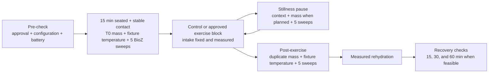

At every BioZ time point:

1. Seat the participant with the arm supported in the Stage 2 position.
2. Record elapsed time, heart rate, room temperature, the MCP9808 fixture channel, the ADXL362 stillness metric/configuration, sweat/skin state, intake, urine, and protocol deviations.
3. Wait for the predeclared stillness interval; run contact and motion checks.
4. Collect five sweeps. Apply the predeclared repeatability, saturation, spectrum, and fit gates.
5. Store rejected sweeps. Do not average rejected and accepted sweeps together.
6. Display no fluid category when $Q<40$ or a hard reject is present.

Primary analysis shall be within-subject:

| Analysis | Required result |
| -------- | --------------- |
| Direction | **Hypothesis:** RFDS increases with $BML_{net}$; rehydration timing is exploratory because an arm-worn study observed a multi-hour local-BioZ lag after intake ([Jankovic et al., 2025](https://pmc.ncbi.nlm.nih.gov/articles/PMC12304993/)). |
| Signal vs noise | The observed within-subject RFDS change must exceed that participant's Stage 2 reattachment/repeatability error. |
| Association | Compute within-subject slope and correlation with $n$ and uncertainty; with only four or a few points, treat both as descriptive and do not substitute a pooled group correlation. |
| Control drift | Compare exercise-session change with control-session change over similar elapsed time. |
| Artifact behavior | Confirm known motion, sweat, contact, temperature, saturation, and poor-fit events are rejected/downgraded. |
| Secondary features | Report BFD-z, $\theta_{50}$, $R_\infty$, fixture temperature, the motion metric, and flags, but do not let exploratory features replace failed RFDS results. |

Pilot interpretation:

| Level | Required achievement | Allowed conclusion |
| ----- | -------------------- | ------------------ |
| Fail | Repeatability error is as large as or larger than the observed fluid-loss response, direction is inconsistent, or confident outputs survive obvious artifacts. | No fluid-trend claim. Return to Stage 2 or pivot. |
| Feasibility signal | RFDS direction is generally positive with $BML_{net}$ within participants, observed range exceeds participant-specific repeatability error, and control drift is smaller. | Exploratory within-subject association only. |
| Rehydration support | Accepted RFDS eventually moves toward baseline after intake, with lag and deviations reported. | Exploratory reversibility evidence; no fixed 60-minute requirement. |
| Accuracy claim | Not assignable in Stage 3, regardless of a large $r$. | Requires powered, independent Stage 5 validation. |

No “good/strong” $r$ thresholds are retained: with four paired points, a large correlation can occur by chance and its uncertainty is too wide for a pass/fail accuracy label. <!-- REVIEW 2026-08-26: Removed unjustified $r>0.6/0.75$ gates and accounted for published rehydration lag. -->

If a BML% model is explored, label it hypothesis-generating. Report leave-one-participant/session-out MAE, RMSE, mean bias, prediction intervals, coverage, and the very small test count. Keep all rows from one participant/session in one partition to prevent adjacent measurements from leaking into both train and test data. With 3–5 participants, “held out” does not mean independently validated. <!-- REVIEW 2026-08-26: Defined held-out behavior and prevented overstatement from tiny grouped splits. -->

With only 3–5 participants, Stage 3 can demonstrate feasibility and failure modes. It cannot establish population accuracy or justify “you are dehydrated.”

**Failure branch:** if Stage 3 fails, stop tuning fluid categories on that dataset. Distinguish measurement failure (return to Stage 1/2) from lack of physiological association (retain calibrated BioZ platform characterization). The final claim becomes “upper-arm BioZ platform and controlled pilot; no reproducible fluid-trend signal demonstrated.” <!-- REVIEW 2026-08-26: Added the missing Stage 3 pivot and bounded final claim. -->

**Required output:** locked pilot dataset, participant-level time-series plots, RFDS/BFD-z versus $BML_{net}$ plots, separate estimated-sweat-loss context, control-vs-exercise comparison, artifact rejection matrix, per-participant statistics, excluded-reading log, and a signed claim decision. <!-- REVIEW 2026-08-26: Aligned Stage 3 outputs with the corrected reference equations. -->

---

### 4.9.6. Stage 4 — Free-Living Reliability Pilot

**Purpose:** test whether the already-validated controlled workflow remains conservative, usable, and logistically practical. This stage does not replace controlled reference validation.

**Schedule status:** Stage 4 is stretch work and has no dedicated slot in the baseline 32-working-week schedule. Execute it only after Stage 3 and only if Weeks 25–28 capacity remains; otherwise defer it and do not claim free-living performance. <!-- REVIEW 2026-08-26: Exposed the previous validation-plan/schedule mismatch. -->

Suggested capstone protocol:

1. Enroll 3–5 Stage 2 participants for at least three typical-use days each.
2. Target at least 12 hours of operation per day to test the wearable-prototype battery goal.
3. Request controlled check-ins at waking, before/after exercise, after major fluid intake, and evening; collect opportunistic stillness-gated readings between check-ins.
4. When practical, collect duplicate pre/post-workout body mass using the Stage 3 procedure.
5. Require an immediate seated recheck after every “Low” or “Very low” output. The first alert is unconfirmed until the repeat passes quality gates.
6. Log comfort, skin irritation, strap movement, sweat, charging state, missed prompts, and user interpretation of the wording.

The 3–5 participants, three days, and 12-hour target are provisional feasibility targets, not powered reliability requirements. <!-- REVIEW 2026-08-26: Labeled Stage 4 scope assumptions. -->

Report:

$$
Valid\ Reading\ Yield=
\frac{N_{accepted}}{N_{scheduled\ or\ attempted}}\times100\%
$$

$$
Unconfirmed\ Alert\ Rate=
\frac{N_{alerts\ not\ reproduced\ on\ immediate\ valid\ recheck}}
{N_{alerts\ with\ valid\ recheck}}\times100\%
$$

Use “unconfirmed alert,” not “false alert,” when no independent body-mass/reference measurement exists.

Stage 4 passes for the capstone when:

- hard-gate failures produce zero confident fluid-status outputs,
- required BLE fields and sequence numbers are present for every received record,
- the wearable demonstrates at least the 12-hour battery target or the measured shortfall is traced to a documented component/mode,
- valid-reading yield, rejection causes, unconfirmed-alert rate, low-confidence rate, user recheck compliance, comfort, and skin events are reported,
- free-living results do not contradict the controlled Stage 3 direction strongly enough to invalidate the claim.

No universal numerical target is set yet for valid-reading yield or unconfirmed-alert rate; the pilot must measure these before a product requirement can be justified.

**Required output:** day-level logs, battery traces, packet-completeness report, quality/rejection distributions, alert/recheck table, adverse-skin/comfort log, and recommendation for fixture or algorithm changes.

---

### 4.9.7. Stage 5 — Independent Accuracy Validation (Required Beyond MVP)

Stage 5 is required before describing the system as an accurate estimator of acute body-mass fluid loss. It is outside the current MVP unless time, approvals, and participant access permit.

Required design:

1. Freeze hardware, electrode geometry, firmware, calibration, baseline procedure, quality gates, BFD-z regularization, FTI boundaries, and any BML regression before collecting the test set.
2. Determine participant/session count with a prospective power or precision analysis; do not choose a sample size because it is convenient.
3. Include participants and sessions not used to select features, thresholds, or model coefficients.
4. Keep all measurements from one participant in only one partition during each train/test evaluation.
5. Compare against the predeclared reference protocol and report failures/missing data, not only accepted cases.

These separation, missing-data, and transparent-reporting requirements follow the purpose of independent prediction-model validation; use current reporting guidance such as [TRIPOD+AI](https://www.tripod-statement.org/) when Stage 5 is designed. <!-- REVIEW 2026-08-26: Added an accessible methodological source for model-development/validation reporting. -->

For a continuous BML% estimate, report MAE, RMSE, mean bias, prediction intervals, coverage, and error versus body-mass-loss level, temperature, sweat, sex, body composition, and arm circumference. For FTI categories, report the confusion matrix, sensitivity, specificity, predictive values, and calibration against predeclared reference categories.

The team shall set acceptable accuracy limits before opening the independent test results. If those limits are not met, the output remains a BioZ trend, not an accurate hydration-status estimate.

---

### 4.9.8. How the Device May Report a BioZ Fluid Trend

The MAX30009 does not directly measure hydration. It measures tissue impedance. For this project, an accurate statement means that a quality-controlled BioZ change agrees with a frozen personal baseline and, after validation, with an acute body-mass-change reference within reported uncertainty.

The runtime decision shall be:

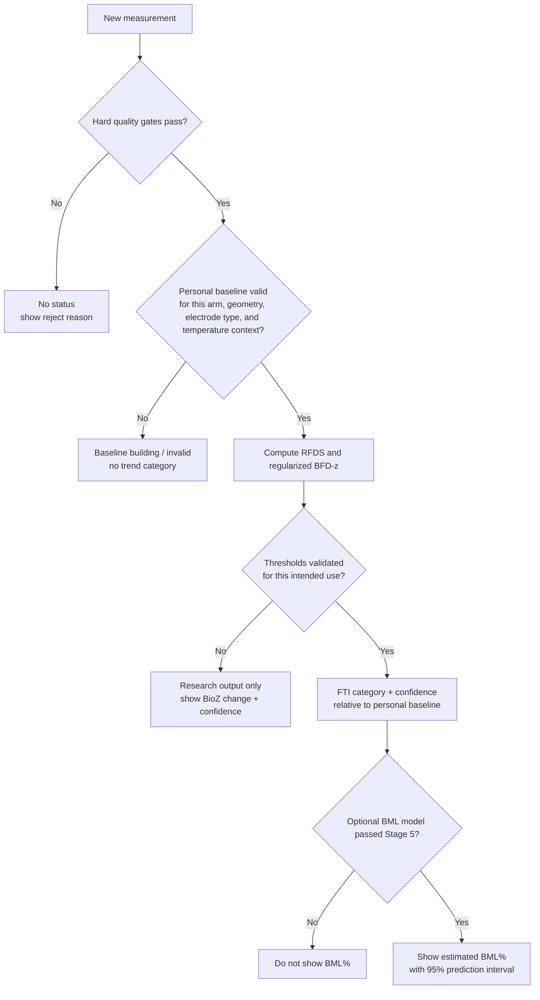

Required interpretation rules:

1. **Baseline is not “fully hydrated.”** It is the person's accepted reference condition under the stored measurement context.
2. **Positive RFDS is not automatically dehydration.** It is a low-conductivity-direction BioZ change that may also reflect temperature, perfusion, contact, or placement; an independent salt effect remains unverified for this setup.
3. **Confidence describes measurement quality, not medical certainty.** High confidence means the artifact checks passed; it does not prove the physiological cause.
4. **A failed gate produces no fluid category.** Do not replace missing evidence with the last value or a model prediction.
5. **The strongest MVP output is relative:** “Low vs personal baseline, confidence medium; recheck seated and still.”
6. **Exact hydration percentage remains out of scope.** The planned references do not establish total body water, plasma osmolality, or clinical dehydration.

Therefore, after Stages 1–3 pass, the project may report an **experimentally supported relative BioZ fluid trend for this controlled prototype and studied participants**. Stage 3 alone does not establish individual accuracy or population generalization. A quantitative acute body-mass-loss estimate requires the independent Stage 5 gate and must always include uncertainty. <!-- REVIEW 2026-08-26: Softened an accuracy claim that a 3–5-person feasibility pilot cannot support. -->

---

## 4.10. Safety Design

### 4.10.1. Current Limit

**Provisional bring-up setting:** begin at the lowest MAX30009 current setting supported by the frozen configuration and measurable with the available equipment.

$$
I_{body}(f) \le I_{reviewed}(f,\ applied\ part,\ fault\ condition)
$$

There is **no universal 1 mA RMS cap in this plan**. The previous statement that 1 mA was conservative across the BioZ sweep was unsupported because the applicable limit depends on frequency, applied-part classification, normal/single-fault condition, waveform definition, and the institution's interpretation. `[UNVERIFIED — the IEC 60601-1 normative current tables were not accessible during this review]` ([IEC 60601-1 catalog entry](https://webstore.iec.ch/publication/2612)). <!-- REVIEW 2026-08-26: Removed the unsupported and potentially unsafe universal current cap and documented why. -->

The MAX30009 datasheet describes a built-in low-frequency current limiter associated with IEC 60601-1, but that feature does not certify the complete prototype ([MAX30009 datasheet](https://www.analog.com/media/en/technical-documentation/data-sheets/MAX30009.pdf)). Before human testing, a qualified reviewer must document the applicable limits, peak/RMS convention, component tolerances, and single-fault cases. Bench verification on low-impedance phantoms is necessary but not sufficient evidence of human-use safety. <!-- REVIEW 2026-08-26: Scoped the chip lockout claim and added system-level/single-fault dependencies. -->

---

### 4.10.2. Required Protections

| Protection                 | Requirement                                                                                                             |
| -------------------------- | ----------------------------------------------------------------------------------------------------------------------- |
| AC coupling                | Required in body current path.                                                                                          |
| Current limit              | Hardware and firmware limits.                                                                                           |
| Frequency/current lockout  | Use and bench-test the MAX30009 low-frequency current limiter; treat it as supplemental, not system certification ([datasheet](https://www.analog.com/media/en/technical-documentation/data-sheets/MAX30009.pdf)). |
| Lead-off/contact detection | Required before current drive.                                                                                          |
| Saturation detection       | Reject reading.                                                                                                         |
| Watchdog                   | Required during active drive.                                                                                           |
| Charging lockout           | MVP shall disable and fail closed on all measurement while USB/charger power is present; isolated charging is out of baseline scope. A bench-only override for disconnected-electronics/phantom work (§4.5.1) is flagged in every record and prohibited for body-connected measurement. |
| Electrode materials        | Document material/adhesive identity, wear duration, skin inspection, and institutional biocompatibility decision; `[UNVERIFIED — final materials not selected]`. |
| Human protocol             | Written institutional determination, consent process, exclusion/stop rules, and adverse-event procedure before testing. |
| Single-fault checks        | Test stuck-drive/configuration, short/open protection components, watchdog timeout, and charger-detect failure as directed by the safety reviewer. |
| Broken skin/implants       | Do not measure over broken/irritated skin; implant and other participant exclusions are set by the approved protocol, not by firmware authors. |

<!-- REVIEW 2026-08-26: Made charging fail closed and added missing materials, single-fault, skin, and protocol failure controls. -->

---

## 4.11. Power Budget

The following remains an **unverified planning placeholder**, not a measured power budget. The ADXL362 and MCP9808 parts are now selected, but their modes, breakout-board current, PMIC, battery capacity, regulator efficiency, BLE interval, and final MAX30009 profile are not frozen. <!-- REVIEW 2026-08-26: Replaced the unresolved IMU selection with the selected sensor parts while retaining the unmeasured-system boundary. -->

| Component       | Mode            |                 Estimate |         Duty |           Average |
| --------------- | --------------- | -----------------------: | -----------: | ----------------: |
| MAX30009        | Active BioZ     | TBD from frozen register profile and datasheet | **Assumption:** 5 s / 300 s | Measure on target hardware |
| nRF52840        | BLE TX          | TBD from PHY, TX power, MTU/framing, and interval | short bursts | Measure with final packet flow |
| nRF52840        | Sleep/RTC       | TBD from SDK configuration and retained peripherals | most time | Measure on target hardware |
| ADXL362 breakout | Three-axis motion gate | TBD from selected range, output-data rate, and wake-up/measurement mode | configurable | Measure the complete breakout on the chosen DK rail |
| MCP9808 breakout | Fixture temperature | 200 µA typical while converting ([Adafruit product 1782](https://www.adafruit.com/product/1782)) | TBD sample/shutdown schedule | Measure the board and include I²C pull-up current |
| Regulators/PMIC | Quiescent/conversion loss | TBD; parts not selected | always | Include battery/charger leakage |

Targets:

| Version            | Target                       |
| ------------------ | ---------------------------- |
| EVKIT bench        | USB/bench powered acceptable |
| Wearable prototype | ≥12 h                        |
| Stretch            | ≥24 h                        |
| Product direction  | ≥3 days                      |

Estimate runtime only after these inputs are frozen:

$$
t_{runtime}\approx\frac{C_{battery,usable}}{I_{average,measured}}
$$

State the battery-capacity derating, regulator losses, measurement interval, BLE connection assumptions, sensor sampling modes, and storage writes. The nRF52840 DK current-measurement path may compare firmware modes, but DK debugger, LEDs, regulators, and breakout boards prevent direct extrapolation to a final wearable PCB. Validate the 12-hour goal with a continuous logged discharge test; extrapolating from a short current trace is insufficient. If the goal fails, the capstone may use a bench-powered demo but shall report that the wearable-runtime requirement failed. The 24-hour and three-day rows are stretch/product-direction aspirations, not scheduled commitments. <!-- REVIEW 2026-08-26: Added the selected sensor loads and bounded what DK power measurements can establish. -->

---

# Appendix A — Verification Summary

| Claim group | Review status | Evidence boundary |
| ----------- | ------------- | ----------------- |
| MAX30009 I/Q, interfaces, FIFO, ADC/ENOB, frequency range, contact features, calibration, and chip lockout | **Verified from primary datasheet** | System accuracy and safety still require configuration-specific bench tests. |
| MAX30009EVKIT GUI, two-board topology, live display/logging, and SPI-to-BLE PC path | **Verified from primary EVKIT guide; EVKIT selected** | Exact physical-board flex pinout, interposer, and nRF52840 execution remain unverified. |
| External-MCU MAX30009 SPI framing and tagged FIFO precedent | **Verified from ADI public MAX32655 example source** | The example is not an nRF52840 driver; its GSR settings/component changes and contradictory `J7` README instruction are not adopted. |
| nRF52840 CPU, memory, BLE, SPI/TWI, USB, and DK development features | **Verified from Nordic sources; two DKs selected** | Board revisions, pin allocation, and power/processing margin for the final workload are not verified. |
| ADXL362 and MCP9808 interfaces/capabilities | **Verified from manufacturer/product sources; one ADXL362 and one MCP9808 breakout selected** | Breakout revisions, electrical integration, placement, timing, and gate performance are not verified. |
| Sweat, temperature, posture, pressure, placement, motion, and electrode-interface confounding | **Verified in open review literature** | This project's detector sensitivity/specificity is unverified. |
| Cross-arm upper-arm precedent and same-side limitation | **Verified in one open 2025 pilot** | Eight analyzed dehydration participants, diuretic protocol, and one 24-hour participant do not establish exercise or population accuracy. |
| Cole frequency model and $R_0$, $R_\infty$, $R_{ICF}$ relation | **Verified in open full text** | Equivalent-circuit interpretation and exponent convention remain model choices; 340 kHz identifiability is unverified. |
| Acute body mass, USG, and multi-marker limitations | **Verified in open sports-hydration sources** | $BML_{net}$ is a short controlled proxy, not absolute hydration ground truth. |
| Local Cole/RFDS/BFD-z calculations | **Reproduced on 2026-08-26** | Synthetic consistency only; no AFE or human validity. |
| BLE MTU/framing dependency | **Verified from Bluetooth/Nordic sources plus schema byte count** | Fragmentation, phone interoperability, loss recovery, and throughput are unimplemented. |
| Human-subject review requirement | **Verified from HHS/eCFR** | The project's institutional determination is not yet documented. |
| Universal ≤1 mA RMS safety cap | **Corrected — unsupported and removed** | A qualified reviewer must obtain the applicable frequency/applied-part/fault limits from the normative standard. |
| 32-week completion forecast | **Unverified planning target** | No owner-hour estimates, dates, component-availability dates, or approval duration are loaded. |

<!-- REVIEW 2026-08-26: Replaced subjective “appropriate/reasonable” verification labels and the obsolete 1 mA status with evidence-bounded claims. -->

---

# Appendix B — Sources Used in This Review

1. Analog Devices, [MAX30009 Datasheet, Rev. 2](https://www.analog.com/media/en/technical-documentation/data-sheets/MAX30009.pdf).
2. Analog Devices, [MAX30009EVKIT Evaluation Kit Guide](https://www.analog.com/media/en/technical-documentation/data-sheets/max30009evkit-evk-rev2.pdf).
3. Nordic Semiconductor, [nRF52840 product page](https://www.nordicsemi.com/Products/nRF52840) and [product specification](https://docs.nordicsemi.com/r/bundle/ps_nrf52840/page/keyfeatures_html5.html).
4. Analog Devices, [MAX30009 no-OS driver documentation](https://analogdevicesinc.github.io/no-OS/drivers/afe/max30009.html). The accessible example documents I²C, not the planned SPI integration.
5. Analog Devices, [MAX32655-to-MAX30009 SPI example](https://github.com/analogdevicesinc/MAX32655_MAX30009). Used only as a reviewed reference for external-MCU SPI framing, initialization examples, and tagged FIFO parsing.
6. Iftime et al., 2025, [Confounding Factors and Their Mitigation in Measurements of Bioelectrical Impedance at the Skin Interface](https://doi.org/10.3390/bioengineering12090926).
7. Jankovic et al., 2025, [Wireless arm-worn bioimpedance sensor for continuous assessment of whole-body hydration](https://pmc.ncbi.nlm.nih.gov/articles/PMC12304993/).
8. Armstrong et al., 2025, [Reference Values for Hydration Biomarkers](https://pmc.ncbi.nlm.nih.gov/articles/PMC11989602/).
9. McDermott et al., 2017, [National Athletic Trainers' Association Position Statement: Fluid Replacement for the Physically Active](https://pmc.ncbi.nlm.nih.gov/articles/PMC5634236/).
10. Brantlov et al., 2025, [Cell Membrane Capacitance Measured by Bioimpedance Spectroscopy](https://pmc.ncbi.nlm.nih.gov/articles/PMC12299080/).
11. Khalil et al., 2014, [The Theory and Fundamentals of Bioimpedance Analysis](https://pmc.ncbi.nlm.nih.gov/articles/PMC4118362/).
12. HHS, [45 CFR 46 overview](https://www.hhs.gov/ohrp/regulations-and-policy/regulations/45-cfr-46/index.html) and [45 CFR 46.109](https://www.ecfr.gov/current/title-45/subtitle-A/subchapter-A/part-46/subpart-A/section-46.109).
13. Bluetooth SIG, [Attribute Protocol specification](https://www.bluetooth.com/wp-content/uploads/Files/Specification/HTML/Core-54/out/en/host/attribute-protocol--att-.html), and Nordic Developer Academy, [ATT MTU data-exchange exercise](https://academy.nordicsemi.com/courses/bluetooth-low-energy-fundamentals/lessons/lesson-4-bluetooth-le-data-exchange/topic/blefund-lesson-4-exercise-3/).
14. [TRIPOD+AI reporting guidance](https://www.tripod-statement.org/) for future prediction-model development and external validation.
15. Analog Devices, [ADXL362 datasheet](https://www.analog.com/media/en/technical-documentation/data-sheets/adxl362.pdf), and SparkFun, [ADXL362 accelerometer breakout](https://www.sparkfun.com/products/11446). Used for the selected three-axis SPI motion sensor; the physical breakout revision remains to be inspected.
16. Microchip, [MCP9808 product page and datasheet](https://www.microchip.com/en-us/product/mcp9808), and Adafruit, [MCP9808 temperature breakout](https://www.adafruit.com/product/1782) plus [pinout/address guide](https://learn.adafruit.com/adafruit-mcp9808-precision-i2c-temperature-sensor-guide/pinouts). Used for the selected fixture-temperature channel and its I²C address.

## Normative Source Not Accessible in Full

17. IEC, [IEC 60601-1 catalog entry](https://webstore.iec.ch/publication/2612). The catalog link works, but the normative patient-current tables are paywalled and were **not independently verified** in this review. Obtain institutional access before human testing.

<!-- REVIEW 2026-08-26: Rebuilt the reference list from sources actually used, linked open full text where available, and isolated the inaccessible safety standard. -->

---

# Changelog / Review Summary

## Revision 2026-11-14

- §4.5 now holds the device state machine (from `docs/state_machine.puml`) with the §4.4 pipeline nested inside `MEASURING`, `PROCESSING`, and `RESULT_READY`; added LED, button, and build-time configuration subsections.
- Rejected readings are always stored with their reason; the diagram's discard path was removed.
- Measurement mode and baseline collection are fixed at build time in `prj.conf`; every record carries build-identity flags.
- `SLEEP`/`SHUTDOWN` use System ON idle during debugging because nRF52840 System OFF has no RTC wake.
- BLE idle advertises only to bonded peers; pairing is a timed open window; the consumer is a phone/test logger.
- Hydration LED colors are build-gated and off by default; "over-hydrated" became "above baseline".
- Reduced temperature sensing to one MCP9808 fixture channel; removed `ambient_temp_centi_c` (record minimum now 39 bytes); room temperature is manual session context.
- Added §4.3.14 synthetic pipeline validation with a scenario set, oracle mode, and a single-precision tolerance rule.

## Verified

- MAX30009, EVKIT, and nRF52840 capabilities now have inline primary-source links.
- The EVKIT two-board topology and ADI's separate external-MCU SPI transaction/FIFO precedent are now documented with their evidence boundaries.
- BioZ frequency behavior, Cole-model interpretation, electrode configurations, and major skin-interface confounders now cite open full text.
- Acute body-mass/USG limitations, human-subject review, and BLE MTU behavior now cite accessible authoritative sources.
- [bioz_pipeline_check.py](bioz_pipeline_check.py) was executed on 2026-08-26; all numbers retained in §4.3.13 were reproduced.
- Added §4.1.6 with ADXL362 and MCP9808 datasheet Table 1/feature specifications (measurement range, resolution, noise density, sensitivity/accuracy error, operating conditions), and carried the same figures into the §4.4.3 and §4.4.4 accuracy discussions.

## Corrected

- Replaced generic MCU/sensor placeholders with two nRF52840 DKs, one ADXL362 breakout, one MCP9808 breakout, and a MAX30009EVKIT, with their development roles and interface boundaries.
- Retained 500 kHz as the guaranteed MAX30009 drive ceiling; 806 kHz remains unguaranteed prose.
- Corrected the ADI support description: its no-OS example is I²C-oriented, while a separate MAX32655 SPI example exists but is not a drop-in nRF52840 driver.
- Added the 1.8 V logic boundary, reversible interposer, single-master/no-backfeed rules, byte-level SPI framing, FIFO parsing contract, and staged stock-EVKIT comparison.
- Split $BML_{net}$ from cumulative estimated sweat loss; the earlier formula was mislabeled.
- Corrected BFD-z's scaled covariance terminology and stated that it is not a standard z-score.
- Closed the RFDS = 4% FTI boundary, added the missing negative-RFDS branch, and changed UI wording to “BioZ Fluid Trend.”
- Removed fixed $r>0.6/0.75$ pilot gates, universal 1 mA safety language, three nonexistent schedule buffers, and post-outcome threshold tuning.
- Repaired FSM reject/logging/timeouts, resolved scoring ownership, added BLE version/framing requirements, and added missing §3.2 ownership definitions.
- Added Gate 4b for frozen personal baselines and corrected 32-week/calendar arithmetic.

## Still Unverified

- Institutional authorization, applicable IEC current limits, applied-part classification, and final electrode/adhesive suitability.
- Physical-board FFC pin mapping, level translator/interposer implementation, MAX30009/nRF52840 SPI/FIFO execution, actual current waveform, calibration accuracy, and 340 kHz Cole-parameter identifiability.
- Personal-baseline stability, RFDS/BFD-z physiological value, all thresholds/penalties, and sweat/motion/temperature detector performance.
- Exercise-induced fluid-trend association, rehydration timing, population generalization, dry electrodes, Garmin integration, Stage 4, and any BML% estimator.
- ADXL362/MCP9808 breakout revisions, bus integration, placement, timing, gate performance, final PMIC/battery choices, 12-hour runtime, BLE fragmentation interoperability, and the 32-week effort forecast.

## Open Risks / Owner Actions

1. Safety lead/faculty: obtain the normative IEC table and written institutional determination before any human work.
2. Whole team: enter real dates, owner-hours, equipment reservations, and component-availability dates by the end of Sprint 1.
3. EE/SW leads: choose and freeze the Cole exponent convention, register profile, current units, packet schema, and calibration format before Stage 1.
4. Algorithm lead: predeclare identifiability, uncertainty, missing-data, and reduced-feature fallback rules before seeing Stage 3 outcomes.
5. Firmware lead: reconcile `firmware/src/fsm/` and `docs/state_machine.puml` with §4.5, implement fail-safe timeouts, reject persistence, and bounded pending storage, and run the §4.3.14 scenario set before AFE integration.
6. Team reviewer: decide whether Stage 4 is funded/scheduled; absent an explicit slot, remove free-living performance from final claims.
7. EE1/EE3/SW1: record each board revision and the EVKIT's exact flex/test-point pinout; then bench-verify the translated MAX30009 path and the separate ADXL362/MCP9808 channels before enabling human-data collection.

<!-- REVIEW 2026-08-26: Added the requested end-of-document audit summary, including verified, corrected, unresolved, and owner-action items. -->

